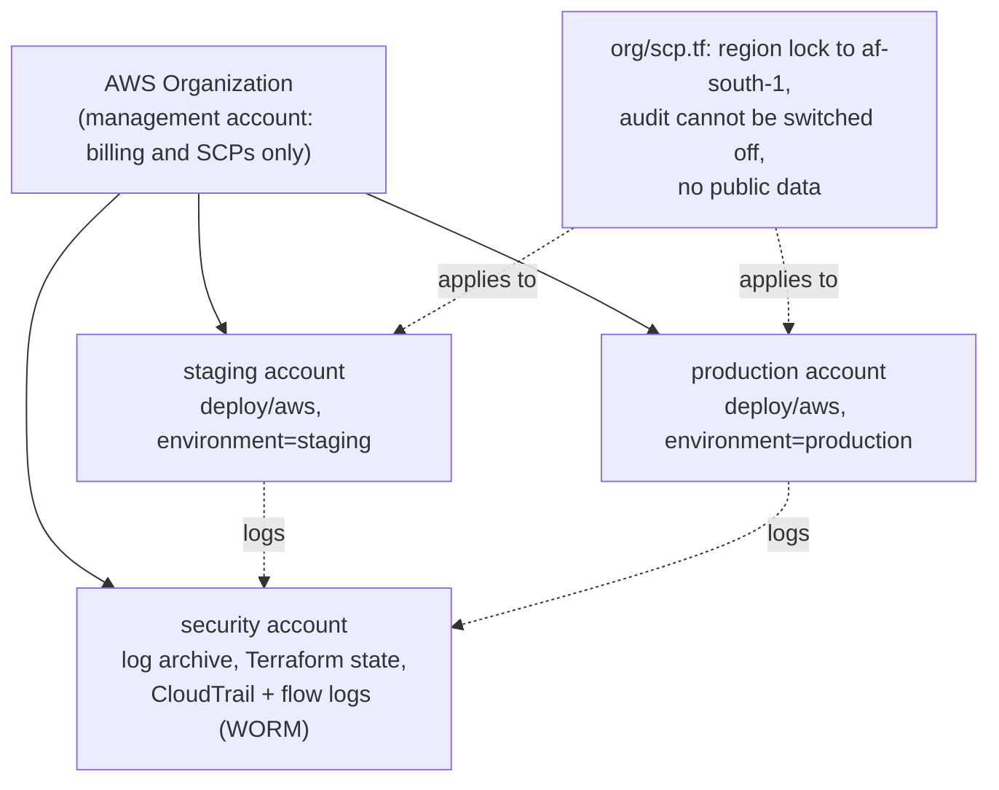

# AWS landing zone (draft, never planned or applied)

> **Status.** Written and checked on paper (`python3 -I scripts/check-aws.py --selftest`, in `make test-regulatory`). No
> Terraform binary, AWS account or credentials are connected to this work, so **it has not been planned, validated by
> Terraform, or applied**, and AWS service names, instance types and regional availability are from general knowledge
> (every doubtful one is marked VERIFY or PLACEHOLDER). Read it as a design to review, not infrastructure that exists.
> Direction and reasoning: `docs/HOSTING.md`.

## Target accounts

Staging and production are the same code with `environment` set; production is created only after staging has run the
journeys (`make test-stack-mtls`) against it.

## What each file does

| File | Purpose |
|---|---|
| `versions.tf`, `variables.tf` | Provider, remote state; **region locked to `af-south-1`** by a validation. |
| `network.tf` | VPC across three zones; private and data subnets (data has no internet route); NAT; flow logs to WORM; private endpoints for AWS services. |
| `kms.tf` | One rotated key per purpose: data, ledger, secrets, logs, backups. |
| `storage.tf` | **WORM buckets** (Object Lock, COMPLIANCE mode, TLS only, no public access): audit anchors, returns, flow logs, CloudTrail, backups. Answers VERIFY-WORM. |
| `eks.tf` | Kubernetes for `deploy/k8s`: private API, secrets encrypted with our key, all control-plane logs, IMDSv2 only, pod roles (IRSA). |
| `data.tf` | Postgres 17 (multi-AZ, encrypted, TLS forced, 35-day point-in-time recovery, deletion protection) and a three-broker Kafka (TLS, SCRAM, replication 3, two in sync). |
| `tigerbeetle.tf` | Six dedicated ledger hosts, two per zone, encrypted `io2` volumes, reachable only from the ledger gateway's pods. |
| `pca.tf` | The subordinate CA behind the services' mutual TLS (`ClusterIssuer forge-service-ca`). |
| `secrets.tf` | Empty Secrets Manager containers per service, and a read-only role for External Secrets. Values never appear in Terraform. |
| `security.tf` | CloudTrail (validated, WORM), GuardDuty, Security Hub, AWS Config. |
| `org/scp.tf` | Organisation guardrails a workload account cannot lift. |

## Findings that need a decision

1. **Disaster recovery is the hard question.** The register wants a *geographically separate* DR site (JS1-12) and
   prohibits personal data leaving South Africa without a legal basis. AWS's Cape Town region has three zones close
   together; as far as we know there is no second AWS region in South Africa (VERIFY). Options: (a) ask the regulator
   whether three zones in one region satisfy "geographically separate"; (b) put the DR site in Johannesburg on another
   provider (a second material outsourcing); (c) a second AWS region offshore, an offshoring decision needing the board,
   the lawyer and a PA notice. **Do not assume (c).** Until decided, `region` stays locked.
2. **Availability in `af-south-1`** of Private CA, MSK, `i3en` hosts and Security Hub standards is not confirmed. If
   Private CA is missing, run an in-cluster CA with the key in KMS (`pca.tf` comment).
3. **Temporal** is not provisioned here: self-host in the cluster (Helm) or use Temporal Cloud (an outsourcing and
   data-location decision).
4. **Cost** is not estimated. Six `i3en.xlarge`-class hosts, a multi-AZ database, three Kafka brokers, NAT in three
   zones and a six-node cluster are a meaningful monthly bill; get the AWS pricing calculator figure before approval.
5. **Notice to the Prudential Authority**: 20 working days before production hosting starts (`OUT-02`); the outsourcing
   register computes the date once a start is set.

## First steps once an account is connected

1. Read who the caller is (`sts get-caller-identity`) and confirm it is a Forge-only account.
2. Create the organisation, the three accounts and the state bucket by hand once; apply `org/` in the management
   account, then this directory per environment.
3. `terraform init && terraform validate && terraform plan`, review the plan with the CTO and CISO (vacant), then apply
   to **staging only**.
4. Fill the placeholders, install cert-manager and External Secrets, apply `deploy/k8s/overlays/production`.
