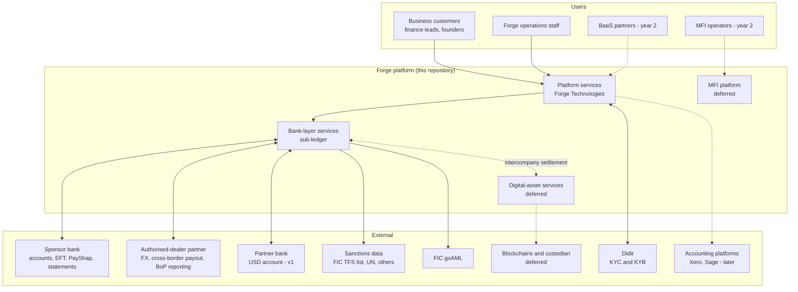
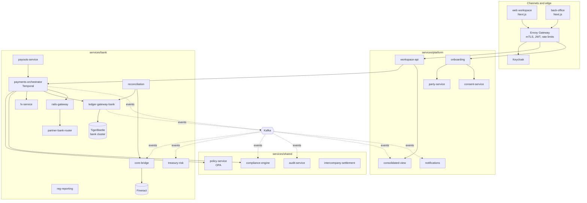

# FORGE: Technical Architecture

Version 1.1 | 27 October 2026 | Status: concept, Phase 0

**v1.1 changes:** ADR-0022 decided (technology companies first, so a USD account via a partner bank is in v1). ADR-0020 handled by building both routes behind a `BankLayer` interface: sponsor-led now, own licence (mutual or bank) later, with own-licence and membership modules designed but not built. See sections 1, 5.2 to 5.5, 12.3, 17.4 and 25.
Place at `docs/ARCHITECTURE.md`. Companion files: `AGENTS.md` (v2.1, repository rules), `docs/adr/`, `docs/specs/<service>/SPEC.md`.

> **Precedence.** `AGENTS.md` governs scope and rules of work. This file governs technical design. Both supersede the technical sections of `BUILD_PLAN.md` v1.1. If any two conflict, stop and record it in `docs/QUESTIONS.md`.
>
> **VERIFY.** Anything marked VERIFY (law, licence terms, vendor behaviour, library versions, file formats) must be confirmed by a human before it is relied on. Coding agents must not invent these facts.

---

## Contents

0. How to use this document with Claude Code
1. Context: what is being built and why
2. Architectural principles and invariants
3. System context
4. Logical architecture
5. Legal-entity boundaries in code
6. Service catalogue
7. Ledger design (TigerBeetle)
8. Core banking (Fineract) and core-bridge
9. Workflows and sagas (Temporal)
10. Policy as code (OPA)
11. Identity, onboarding, party and consent
12. Payments, rails and FX
13. Reconciliation
14. Intercompany settlement
15. Compliance and regulatory reporting
16. Digital-asset entity (deferred)
17. MFI platform (year 2)
18. Data architecture and events
19. APIs
20. Security architecture
21. Infrastructure, environments and operations
22. Observability
23. Testing strategy and quality gates
24. Repository layout
25. Build sequence for Claude Code
26. Architecture decisions (ADRs)
27. VERIFY register
- Appendix A: Open-source component register
- Appendix B: Ledger codes
- Appendix C: Event catalogue
- Appendix D: Glossary

---

## 0. How to use this document with Claude Code

1. Put `AGENTS.md` at the repository root and this file at `docs/ARCHITECTURE.md`. Claude Code reads `AGENTS.md` (or `CLAUDE.md`) automatically; point it to the relevant sections of this file per task.
2. Work one task at a time from section 25. Each task names the sections it needs. Do not paste the whole file into every prompt.
3. Spec first: every service gets `docs/specs/<service>/SPEC.md` before code. The spec is a deliverable that a human reviews.
4. Tests first: ledger invariants as property tests, idempotency tests and failure-path tests before features.
5. CI is the arbiter, not the agent's report. `make ci` must pass.
6. Agents never touch production, real keys, real customer data or real money. Everything runs against simulators, sandboxes and testnets.
7. Money-path changes (anything that moves money, touches keys, or changes permissions) need two human reviews.

**Kickoff prompt (once per session)**

> You are building Forge. Read `AGENTS.md` and `docs/ARCHITECTURE.md` sections 1, 2 and 5. Your task is `<ID>` from section 25. Write or update the service SPEC.md first, then tests, then code. Never invent regulatory, vendor or format facts; record unknowns in `docs/QUESTIONS.md` marked VERIFY. Stop and ask when a task touches an open ADR (section 26).

**Task prompt**

> Task `<ID>`: `<title>`. Read sections `<n>`. Acceptance criteria: `<criteria>`. Deliver code, tests, SPEC.md updates, runbook notes and a PR description with `make ci` output.

**Review prompt (second agent, read-only)**

> Review the PR for task `<ID>` against the invariants in section 2 and the checklist in section 23.4. List defects, missing tests, risky assumptions and unverified regulatory claims. Do not modify code.

---

## 1. Context: what is being built and why

### 1.1 The product

Forge is a business money platform and bank for technology companies and the people who build them, starting in South Africa. **Technology companies are the first customer group (ADR-0022, accepted):** startups and scale-ups, profitable software houses and agencies, AI and deep-tech firms. The first product is ZAR and USD business accounts with cross-border payments and receipts, in one workspace for accounts, payments, FX, payroll and accounting. Adjacent cross-border SMEs are welcome on the same product to diversify deposits. Later, an MFI network extends reach to underserved borrowers.

### 1.2 The staged route

| Stage | Bank layer | On-chain | What the code must support |
|---|---|---|---|
| A (now) | Sponsor bank holds deposits; Forge runs a sub-ledger | None in v1 | Sponsor adapter, three-way reconciliation, sub-ledger semantics |
| B (licensed) | Forge Mutual Bank or own bank licence | Tokenised deposits inside the bank perimeter | Swap the sponsor adapter for direct rails; enable tokenised-deposit asset behind a licence flag |
| C (cleared) | Unchanged | Stablecoin corridors via the separate digital-asset entity | Digital-asset services and intercompany settlement |

The open-source core is identical across all three stages. Design so that Stage B and C are configuration and new adapters, not rewrites. The switch from Stage A to Stage B is a change of `BankLayer` implementation (section 5.2), not a rewrite.

**Stage B has two possible legal forms (ADR-0020, open):** a mutual bank owned by its depositors, or a bank under the Banks Act. The code supports both: everything licence-specific sits behind `BankLayer`, and everything mutual-specific sits in a membership module that is designed now and built only if ADR-0020 chooses a mutual (section 5.4).

### 1.3 Legal entities

| Entity | Code | Holds | Never holds |
|---|---|---|---|
| Forge Technologies (Pty) Ltd | `PLAT` | Product, workspace, party and consent data, consolidated view | Customer money, crypto |
| Bank layer (sponsor now; own licence later, mutual or bank per ADR-0020) | `BANK` | ZAR and foreign-currency deposits, payments | Crypto, stablecoins |
| Digital-asset entity (deferred) | `DAST` | Stablecoin custody, on/off-ramp | Deposits |
| MFI tenants (year 2) | `MFI:<tenant>` | Each MFI's own loan book and, if a registered co-op, member savings | Another tenant's data or money |

### 1.4 v1 scope

In v1:
- ZAR business accounts at the sponsor, with a Forge sub-ledger.
- **A USD account via one partner bank**, mirrored in the bank ledger, for receiving foreign revenue and paying USD costs (cloud, contractors, SaaS).
- Cross-border payouts and FX via an authorised-dealer partner.
- KYB/KYC via Didit; party and consent services; founder-and-company separation.
- Compliance core (sanctions, monitoring, goAML); concentration and outflow alerts (tech deposits are volatile).
- Web workspace (balances by currency, payments, approvals, team roles) and back-office.
- The `BankLayer` interface with `SponsorBankLayer` as the only implementation.

Deferred: everything in the digital-asset entity, tokenised deposits, cards, PayShap direct participation, USSD, WhatsApp, mobile, BaaS partner API, MFI platform, credit bureau, lending, DeFi, self-custody, Forge-issued stablecoins, `OwnLicenceBankLayer`, the membership module. EUR and GBP accounts follow USD once the partner-bank pattern is proven.

---

## 2. Architectural principles and invariants

### 2.1 Principles

1. **Commands go down, events go up.** Services never read another service's database. They call APIs or consume events.
2. **One authority per fact.** Balances: TigerBeetle. Customers and products: Fineract and party-service. Permissions: Keycloak plus OPA. Consent: consent-service.
3. **Legal entities are hard boundaries.** Separate ledgers, databases, credentials and namespaces.
4. **Everything money-moving is a durable workflow.** Every step has a compensation.
5. **Rules are data.** Limits, sectors, pricing and eligibility live in OPA bundles, never hard-coded.
6. **Swappable vendors.** Every external dependency (sponsor bank, authorised dealer, KYC, sanctions data, HSM, hosting) sits behind an interface with a simulator.
7. **Fail closed.** Stale sanctions lists, missing consent, reconciliation breaks and unknown assets all deny.
8. **Open and sovereign.** Self-hostable open-source components with licences recorded; no hard dependency on one foreign cloud.

### 2.2 Invariants (CI enforces; a change that breaks one does not merge)

**Money**
1. Conservation per asset per ledger: sum of debits equals sum of credits. Money is created or destroyed only through audited mint/burn or external settlement accounts.
2. No negative customer balances unless the product allows overdraft and the account carries the flag.
3. Multi-leg operations within one TigerBeetle cluster are atomic (linked transfers).
4. Every money-moving command carries an idempotency key; replays return the original result and never move money twice.
5. Money is integers in minor units. No floating point anywhere for money.

**Legal entities**
6. One writer per ledger cluster: only `ledger-gateway-bank` writes to the bank cluster; only `ledger-gateway-dasset` writes to the digital-asset cluster; only `ledger-gateway-mfi` writes to the MFI cluster.
7. No transfer spans two entities' ledgers. Cross-entity value moves only via `intercompany-settlement`.
8. The bank cluster rejects third-party stablecoin asset codes. Tokenised-deposit assets are rejected unless `licence.bank.own = true` and the asset is approved.
9. Daily reconciliation of the bank sub-ledger against sponsor and partner-bank statements and against Fineract. A break alarms and blocks outbound payments above a policy threshold until resolved.

**Customers and data**
10. Every balance shown to a customer carries its holding entity and deposit-insurance status.
11. No third-party data is accessed, stored or used without a recorded, purpose-bound, revocable consent.
12. Founder and company accounts are never commingled; person-to-entity transfers use transfer code `63`, are explicit, logged and policy-approved.
13. MFI tenants are isolated: no read or write crosses tenants.

**Control**
14. Every policy decision and money movement is logged with inputs and policy version; the audit log is append-only and hash-chained.
15. Default deny for every permission, limit, asset, sector and feature flag.
16. When on-chain is enabled: only `signer` signs; keys never leave HSM/MPC in production; ledger leads, chain follows.

---

## 3. System context



**External systems and how Forge connects**

| System | Purpose | Interface (VERIFY exact format after contract) | Simulator |
|---|---|---|---|
| Sponsor bank | Holds deposits in pooled account(s); EFT and PayShap; statements | API, SFTP or ISO 20022 (pain.001 out, pain.002/camt.054 in, camt.053 statements) | `tools/sim/sponsor` |
| Authorised-dealer partner | FX quotes, conversion, cross-border payout, Balance of Payments reporting | Partner API | `tools/sim/ad-partner` |
| Partner bank (USD, v1) | Foreign-currency account: receive foreign revenue, pay USD costs | Partner API, statements (camt.053 or partner format, VERIFY) | `tools/sim/partner-bank` |
| Didit | Identity and business verification | REST API plus signed webhooks | `FakeKycProvider` |
| Sanctions data | Screening lists | Files or API; FIC targeted financial sanctions list is mandatory (VERIFY sources and licences) | Fixture lists |
| FIC goAML | STR, CTR and other reports | goAML XML, official schema (VERIFY) | Schema validation only |

---

## 4. Logical architecture



**Layers**

| Layer | Responsibility | Key components |
|---|---|---|
| Channels and edge | User interfaces, TLS termination, authentication, rate limits | Next.js apps, Envoy Gateway, Keycloak |
| Platform | Customers, parties, consent, workspace, read models; moves no money | onboarding, party-service, consent-service, workspace-api, consolidated-view |
| Orchestration | Durable multi-step operations with compensation | Temporal workers in payments-orchestrator, payouts-service, onboarding |
| Policy and compliance | Allow/deny/step-up decisions; screening; monitoring | policy-service (OPA), compliance-engine |
| Bank layer | Sub-ledger, rails, FX, reconciliation, reporting | ledger-gateway-bank, TigerBeetle, core-bridge, Fineract, rails-gateway, fx-service |
| Digital-asset layer (deferred) | Separate ledger, signing, chain I/O | ledger-gateway-dasset, signer, onchain-watcher, onchain-executor |
| Backbone | Events, read models, audit, telemetry | Kafka, PostgreSQL, OpenTelemetry, audit-service |

---

## 5. Legal-entity boundaries in code

Entity boundaries are enforced at five levels, so a bug at one level does not breach the boundary.

| Level | Enforcement |
|---|---|
| Repository | Services live in `services/platform`, `services/bank`, `services/dasset`, `services/mfi`, `services/shared`. A CI check (`make test-isolation`) rejects imports of another entity's internal packages and any shared database DSN. |
| Kubernetes | One namespace per entity (`forge-plat`, `forge-bank`, `forge-dasset`, `forge-mfi`, `forge-shared`). Cilium network policies default deny; only listed service-to-service calls are allowed. |
| Identity | Each service has its own workload identity (SPIFFE-style ID via service account and mTLS). Credentials are scoped per entity in OpenBao paths `secret/<entity>/<service>`. |
| Data | One PostgreSQL cluster per entity (CloudNativePG), one database per service. One TigerBeetle cluster per money-holding entity. |
| Ledger semantics | The bank gateway rejects non-fiat assets; cross-entity value moves only via `intercompany-settlement` with matching legs. |

**Shared services** (`policy-service`, `compliance-engine`, `audit-service`, `intercompany-settlement`) serve all entities but partition data by `entity_code` and hold no balances.

### 5.2 The bank-layer abstraction (ADR-0020)

The two routes, sponsor-led and own licence, share about 90% of the architecture. Everything above the bank layer is identical: platform, workflows, policy, compliance, ledger, reconciliation and apps. Everything that differs sits behind one interface in `pkg/banklayer`, defined in Phase 0 and used by every bank-layer service from day one.

```go
package banklayer

// BankLayer is the only place that knows whether Forge runs on a sponsor bank
// or under its own licence. No other package may branch on the licence route.
type BankLayer interface {
    // Accounts
    OpenAccount(ctx context.Context, req OpenAccountRequest) (Account, error)
    CloseAccount(ctx context.Context, accountID string, reason string) error

    // Movement of money outside Forge's books
    Rails() []rails.Rail                     // sponsor-routed now, direct later
    ForeignCurrency() []fx.ForeignAccountProvider // partner banks for USD (v1), EUR, GBP

    // Evidence for reconciliation
    StatementSource() StatementSource        // sponsor and partner statements now; own settlement accounts later

    // Regulatory duties that depend on who holds the licence
    DepositInsurance() InsuranceReporter     // sponsor-reported now; Forge reports to CODI later
    PrudentialReporter() PrudentialReporter  // no-op now; regulatory returns later

    // What this route allows; read by OPA as data
    Capabilities() Capabilities
}

type Capabilities struct {
    Route                 Route // ROUTE_SPONSOR, ROUTE_OWN_LICENCE
    LegalForm             LegalForm // LEGAL_FORM_NONE, LEGAL_FORM_MUTUAL, LEGAL_FORM_BANK
    DirectClearing        bool  // PayShap and clearing participation
    TokenisedDeposits     bool  // only true under own licence, after approval
    MemberShares          bool  // only true for a mutual
    LegalBookOfRecord     BookOfRecord // BOOK_SPONSOR or BOOK_FORGE
}
```

**Implementations**

| Implementation | When | What it does |
|---|---|---|
| `SponsorBankLayer` | v1 | Accounts are sub-ledger accounts inside the sponsor's pooled account; rails route through the sponsor; statements come from the sponsor and the USD partner bank; deposit insurance is the sponsor's duty; prudential reporting is a no-op; `LegalBookOfRecord = BOOK_SPONSOR` |
| `OwnLicenceBankLayer` | Stage B, designed now | Accounts are Forge's own deposit accounts; direct clearing; Forge's own settlement accounts at the Reserve Bank or a clearing bank; Forge reports to CODI and files prudential returns; `LegalBookOfRecord = BOOK_FORGE` |
| `SimBankLayer` | Always | Drives local, dev and CI through the simulators |

**Rules for agents**

1. No service outside `pkg/banklayer` and its adapters may check which route is active. Behaviour that varies by route is expressed as `Capabilities` and evaluated by OPA (`forge.banklayer` package).
2. Both real implementations must pass the same contract test suite (`make test-banklayer`), with route-specific tests on top.
3. The active implementation is chosen by configuration (`config/banklayer.yaml`), never by code changes.
4. Migration from sponsor to own licence is a documented, rehearsed runbook (`docs/runbooks/banklayer-migration.md`): open Forge-held accounts, move balances customer by customer with matching ledger legs, switch rails, reconcile, close sponsor sub-ledger accounts.

### 5.3 Own-licence components (designed now, built at Stage B)

These are needed for any own licence, mutual or not. Write their specs in Phase 2 so the v1 code does not block them; build them only when the licence path is confirmed.

| Component | Purpose | Effort (6–8 person team) | Mutual-specific |
|---|---|---|---|
| `prudential-reporting` | Regulatory returns, capital and liquidity calculations | 3–5 months | No |
| `direct-rails` | PayShap and clearing participation, certification | 4–6 months plus the certification queue | No |
| `deposit-insurance` | CODI depositor data and reporting | 1–2 months | No |
| `treasury-liquidity` | Liquidity management, stress testing, investment of surplus | 2–3 months (extends `treasury-risk`) | No |
| `tokenised-deposits` | The original on-chain vision, inside the bank perimeter | 3–4 months plus a contract audit | No |
| `membership` | Member register, shares, voting, rebates or dividends, AGM records | 2–3 months | **Yes** |

Each has a `docs/specs/<component>/SPEC.md` and a stub package with interfaces only. CI fails if any stub is wired into a running service before its ADR is accepted.

### 5.4 The membership module (mutual only, designed not built)

Built only if ADR-0020 chooses a mutual. Design now so that party and account data can support it later without migration.

**Data model (spec only)**

| Table | Fields |
|---|---|
| `member` | `member_id`, `party_id`, `member_class` (individual, business, MFI, co-operative), `admitted_at`, `status` |
| `member_share` | `member_id`, `share_class`, `units`, `paid_up_minor`, `issued_at`, `redeemed_at` |
| `member_vote` | `resolution_id`, `member_id`, `weight`, `choice`, `cast_at`, `channel` |
| `resolution` | `resolution_id`, `meeting_id`, `text_ref`, `voting_rule`, `result` |
| `meeting` | `meeting_id`, `type` (AGM, special), `notice_sent_at`, `quorum`, `minutes_ref` |
| `member_distribution` | `period`, `member_id`, `basis` (rebate on fees, interest uplift, dividend), `amount_minor`, `paid_transfer_id` |

**Design rules**

- Voting rules (one member one vote, or weighted) are data in OPA, set by the bank's constitution (VERIFY Mutual Banks Act requirements).
- Member share capital is booked in the bank ledger with dedicated account codes (`8001 MEMBER_SHARE_CAPITAL`, `8002 MEMBER_DISTRIBUTIONS_PAYABLE`), reserved now.
- Distributions are calculated by a workflow, approved by maker-checker, and paid as ledger transfers with code `80 MEMBER_DISTRIBUTION`.
- Party data already separates persons, companies and funds, so MFIs and co-operatives can become members without schema changes.

### 5.5 Why both routes are kept open

**What a true mutual would help with**

- Trust: a bank owned by its depositors is a credible story in a market tired of fees.
- The MFI network: MFIs and co-operatives could become members of the bank, an apex structure where the network owns its funder, much like European co-operative banking groups.
- Redistribution: surplus returns to members through better pricing or rebates, not to outside shareholders.
- Stokvels and communities: member ownership fits savings groups culturally.
- Possibly a lower capital hurdle than a commercial bank (the earlier R10M figure is unverified).

**What it costs:** it cannot easily raise venture equity or be sold, it grows more slowly, and it needs a licence before launch.

**Current lean (a hybrid):** a sponsor-led platform now, with a mutual or co-operative structure introduced for the MFI network later (section 17.4). The code supports any outcome because the route lives behind `BankLayer` and the mutual-specific parts live in the membership module.

---

## 6. Service catalogue

Language defaults: Go for anything on the money path; TypeScript for UIs and (later) chain tooling. Every service has `SPEC.md`, `README.md`, `Dockerfile`, Helm chart, `/healthz`, `/readyz`, `/metrics`, and OpenTelemetry instrumentation.

### 6.1 Platform (`services/platform`, entity PLAT)

| Service | Lang | Responsibility | Interfaces | Store | Phase |
|---|---|---|---|---|---|
| onboarding | Go | KYB/KYC workflows (Temporal); creates party, consent, accounts and limits | REST (edge), Didit webhooks, Temporal | Postgres | 1 |
| party-service | Go | Parties (person, company, fund), relationships (director, shareholder, UBO), roles | ConnectRPC | Postgres | 1 |
| consent-service | Go | Consent purposes, scopes, expiry, revocation, audit | ConnectRPC; emits events | Postgres | 1 |
| workspace-api | Go | Backend-for-frontend for the customer workspace | REST (OpenAPI) | Postgres (session-free; reads views) | 1 |
| consolidated-view | Go | Read models: balances by entity, statements, activity | ConnectRPC; consumes events | Postgres | 1 |
| notifications | Go | Email, SMS and push templates | Consumes events | Postgres | 1 |
| baas-api | Go | Partner tenancy, OAuth clients, webhooks, sandbox | REST, OAuth2 | Postgres | Year 2 |
| integrations-hub | Go | Accounting/payroll connectors, token vault | ConnectRPC | Postgres, OpenBao | 2+ |

### 6.2 Bank layer (`services/bank`, entity BANK)

| Service | Lang | Responsibility | Interfaces | Store | Phase |
|---|---|---|---|---|---|
| ledger-gateway-bank | Go | Only writer to the bank TigerBeetle cluster; accounts, transfers, holds, balances, idempotency, outbox | ConnectRPC | TigerBeetle, Postgres | 0–1 |
| core-bridge | Go | Projects ledger events into Fineract; nightly GL reconciliation | Consumes events; Fineract REST | Postgres | 1 |
| payments-orchestrator | Go | Temporal workflows: domestic, cross-border, refund | ConnectRPC; Temporal | Postgres | 1–2 |
| payouts-service | Go | Bulk payouts (contractors, suppliers) as child workflows | ConnectRPC | Postgres | 2 |
| fx-service | Go | Quotes, spreads, quote lock, booking legs | ConnectRPC; AD partner adapter | Postgres | 2 |
| rails-gateway | Go | `Rail` interface; sponsor adapter; ISO 20022 messages; RailSim | ConnectRPC | Postgres, object storage | 1–2 |
| partner-bank-router | Go | Routes foreign-currency operations to partner banks by country, currency, cost and health; USD account in v1 | ConnectRPC | Postgres | 1–2 |
| reconciliation | Go | Statement ingestion (camt.053), three-way recon, breaks, circuit breaker | Batch, ConnectRPC | Postgres, object storage | 1–2 |
| treasury-risk | Go | Deposit concentration, outflow velocity, liquidity alerts, stress scenarios | Consumes events | Postgres | 1 |
| reg-reporting | Go | goAML reports, evidence packs; BoP data handoff to AD partner | Batch | Postgres, WORM storage | 2 |

### 6.3 Shared (`services/shared`)

| Service | Lang | Responsibility | Phase |
|---|---|---|---|
| policy-service | Go + Rego | OPA decision point; signed bundle loading; decision log | 1 |
| compliance-engine | Go | Sanctions screening, monitoring rules, alerts, cases | 1–2 |
| audit-service | Go | Append-only, hash-chained audit log; WORM anchors; verify CLI | 1 |
| intercompany-settlement | Go | Two-sided, arm's-length settlement between entities; daily reconciliation | Stage C (design now) |

### 6.4 Digital-asset (`services/dasset`, entity DAST, deferred)

ledger-gateway-dasset (Go), signer (Go), onchain-watcher (TS), onchain-executor (TS), travel-rule (Go). See section 16.

### 6.5 MFI platform (`services/mfi`, year 2)

ledger-gateway-mfi (Go), mfi-tenant-service (Go), mfi-loans (Fineract multi-tenant via core-bridge-mfi), mfi-portal (Next.js). See section 17.

### 6.6 Apps (`apps/`)

| App | Stack | Users | Phase |
|---|---|---|---|
| web | Next.js, TypeScript, Tailwind | Customer workspace | 1 |
| backoffice | Next.js | Ops: KYC review, cases, payment repair, recon dashboard, maker-checker | 1 |
| dev-portal | Docs site | BaaS partners | Year 2 |
| mfi-portal | Next.js | MFI operators | Year 2 |

API clients are generated from OpenAPI and Protobuf. No hand-written fetch wrappers.

---

## 7. Ledger design (TigerBeetle)

TigerBeetle is the authority for balances and transfers. Read the TigerBeetle documentation for the pinned version before implementing (VERIFY field names, limits and recommended ID scheme for the version in use).

### 7.1 Clusters

| Cluster | Entity | Writer | Stage |
|---|---|---|---|
| `tb-bank` | BANK | ledger-gateway-bank | A |
| `tb-dasset` | DAST | ledger-gateway-dasset | C |
| `tb-mfi` | MFI tenants | ledger-gateway-mfi | Year 2 |

Production: 3 to 6 replicas across failure domains, dedicated nodes, NVMe storage, never shared with other workloads. Development: 1 replica.

### 7.2 Ledgers and asset registry

In TigerBeetle a transfer can only move value between accounts on the same `ledger`. Forge uses one `ledger` number per asset (and, in the MFI cluster, per tenant and asset), which gives hard isolation for free.

Registry lives in `proto/forge/assets/v1/assets.proto` and `config/assets.yaml`:

| Cluster | Ledger | Asset | Scale | Status |
|---|---|---|---|---|
| tb-bank | 710 | ZAR | 2 | Active |
| tb-bank | 840 | USD (partner-bank mirror) | 2 | Active v1 |
| tb-bank | 978 | EUR (partner-bank mirror) | 2 | Later |
| tb-bank | 826 | GBP (partner-bank mirror) | 2 | Later |
| tb-bank | 7100 | ZAR tokenised deposit | 2 | Reserved; rejected unless own licence |
| tb-dasset | 1001 | USD stablecoin (issuer per ADR-0005) | token decimals, commonly 6 | Deferred |
| tb-dasset | 1002 | Rand stablecoin | token decimals | Deferred |
| tb-mfi | `tenant_index * 1000 + iso_numeric` | ZAR per tenant | 2 | Year 2 |

Using ISO 4217 numeric codes for fiat makes ledgers self-describing. The gateway validates every request against the registry and the cluster's allowed set.

### 7.3 Account fields

| Field | Use |
|---|---|
| `id` (u128) | Generated by the gateway (see 7.6) |
| `ledger` (u32) | Asset (and tenant in tb-mfi) |
| `code` (u16) | Account type (Appendix B) |
| `user_data_128` | Internal owner ID (party, system or tenant UUID) |
| `user_data_64` | Product ID |
| `user_data_32` | Entity/tenant partition ID |
| `flags` | Customer: `debits_must_not_exceed_credits` + `history`. System accounts per Appendix B. Overdraft products omit the debit constraint and carry an explicit limit enforced by policy. |

A Postgres `account_directory` maps business identity to TigerBeetle IDs:

```sql
create table account_directory (
  tb_account_id   numeric(39,0) primary key,
  entity_code     text not null,          -- BANK, DAST, MFI:<tenant>
  owner_party_id  uuid,                   -- null for system accounts
  asset           text not null,          -- ZAR, USD...
  ledger          bigint not null,
  code            int not null,
  product_id      text,
  status          text not null,          -- open, frozen, closed
  insured         boolean not null,       -- disclosure (invariant 10)
  created_at      timestamptz not null default now()
);
```

### 7.4 Transfer fields

| Field | Use |
|---|---|
| `id` (u128) | Gateway-generated, bound to the idempotency key (7.6) |
| `debit_account_id`, `credit_account_id` | Same `ledger` |
| `amount` (u128) | Minor units |
| `ledger`, `code` | Asset and transfer type (Appendix B) |
| `user_data_128` | Business transaction UUID (traces every transfer to a workflow) |
| `user_data_64` | Workflow step number |
| `user_data_32` | Entity/tenant partition |
| `flags` | `linked`, `pending`, `post_pending_transfer`, `void_pending_transfer` as needed |
| `timeout` | Seconds for pending transfers, so stale holds expire |

### 7.5 Patterns

**Holds (two-phase).** A payment reserves funds with a pending transfer when accepted; posts when the rail confirms; voids on failure, cancellation or timeout.

**Linked chains.** Multi-leg operations (fees plus principal, FX legs on mirror ledgers) are submitted as one linked chain within one cluster. Linked chains may include transfers on different ledgers of the same cluster (VERIFY for pinned version).

**Fees.** Always a separate transfer to `FEES_INCOME`, never netted silently.

**FX inside tb-bank** (when Forge holds USD mirrors), one linked chain:
1. customer ZAR → `FX_POSITION` ZAR (ledger 710)
2. `FX_POSITION` USD → customer USD (ledger 840)
3. customer ZAR → `FEES_INCOME` ZAR (spread or fee, explicit)

**Cross-border payout from ZAR** (no USD held): customer ZAR → `AD_PARTNER_SETTLEMENT` ZAR as a pending transfer; post when the partner confirms execution. The FX happens at the partner.

**USD payout from the customer's USD account** (v1): customer USD → `PARTNER_BANK_MIRROR` USD (ledger 840) as a pending transfer; post when the partner bank confirms. No FX.

**Inbound USD** (v1, the common tech-company case: foreign customers paying a South African software firm): partner bank notifies the credit → `PARTNER_BANK_MIRROR` USD → customer USD. Converting to ZAR is a separate, customer-initiated FX booking. Exchange-control reporting for inbound flows is handled with the partner (VERIFY).

**Sponsor sub-ledger.** All customer deposits are liabilities against `SPONSOR_POOLED` (code 3003), which mirrors the sponsor's pooled account. Inbound EFT: `SPONSOR_POOLED` → customer. Outbound: customer → `RAIL_SETTLEMENT_<rail>` (pending), post on confirmation, then settle `RAIL_SETTLEMENT` → `SPONSOR_POOLED` when the sponsor statement shows the debit.

### 7.6 Identifiers and idempotency

1. Every money-moving request carries `Idempotency-Key` (edge) / `idempotency_key` (internal).
2. The gateway writes `idempotency_record(key, request_hash, tb_transfer_ids, status, result)` to Postgres before submitting to TigerBeetle.
3. Transfer IDs are generated once (time-ordered, ULID-style, as TigerBeetle recommends for performance; VERIFY) and stored in the record.
4. A retry with the same key and same hash returns the stored result; if the transfer was submitted but the result was lost, the gateway resubmits the same IDs; TigerBeetle returns `exists`, which the gateway treats as success when fields match.
5. Same key with a different payload returns `409 IDEMPOTENCY_CONFLICT`.
6. Records are kept for at least 30 days.

### 7.7 Gateway API (ConnectRPC, `proto/forge/ledger/v1/ledger.proto`)

```protobuf
syntax = "proto3";
package forge.ledger.v1;

message Money {
  string asset = 1;          // "ZAR"
  string amount_minor = 2;   // decimal string of an unsigned integer; never float
}

message TransferLeg {
  string debit_account_id = 1;
  string credit_account_id = 2;
  Money amount = 3;
  uint32 code = 4;
}

message CreateTransfersRequest {
  string idempotency_key = 1;
  string business_txn_id = 2;     // UUID
  string entity_code = 3;         // must match the gateway's entity
  repeated TransferLeg legs = 4;  // submitted as one linked chain
  bool pending = 5;
  uint32 pending_timeout_seconds = 6;
  string actor = 7;               // service or user
  string reason = 8;
}

message CreateTransfersResponse {
  repeated string transfer_ids = 1;
  Status status = 2;              // OK, REPLAYED, REJECTED
  repeated string rejection_codes = 3;
}

service LedgerService {
  rpc CreateAccounts(CreateAccountsRequest) returns (CreateAccountsResponse);
  rpc CreateTransfers(CreateTransfersRequest) returns (CreateTransfersResponse);
  rpc PostPending(PostPendingRequest) returns (CreateTransfersResponse);
  rpc VoidPending(VoidPendingRequest) returns (CreateTransfersResponse);
  rpc GetBalances(GetBalancesRequest) returns (GetBalancesResponse);
  rpc LookupTransfers(LookupTransfersRequest) returns (LookupTransfersResponse);
}
```

**Gateway enforcement:** asset registry and cluster allow-list; entity match; caller allow-list per RPC (deny by default); amount sanity limits; tenant partition check; no business logic beyond enforcement.

**Batching:** coalesce concurrent requests into batches within a few milliseconds, never splitting a linked chain.

### 7.8 Outbox and events

After a successful commit the gateway writes `outbox(event_id, payload)` in the same Postgres transaction as the idempotency record update, then a relay publishes `forge.bank.ledger.transfer.committed.v1` to Kafka. A reconciler compares TigerBeetle lookups with published events and republishes gaps. Consumers are idempotent by `event_id`.

### 7.9 Read model

`consolidated-view` builds balances and statements in Postgres from committed-transfer events for fast UI queries. The ledger authorises; if the read model and the ledger disagree, the ledger wins and an alert fires.

---

## 8. Core banking (Fineract) and core-bridge

**Decision (ADR-0001, to confirm in Phase 0 spike):** TigerBeetle owns balances. Fineract owns customer records, product definitions, fee schedules, loan schedules and interest logic, and a statutory general ledger as a projection.

- `core-bridge` consumes `transfer.committed` events and posts matching journal entries to Fineract via REST, deduplicated by `transfer_id`.
- `projection_state(transfer_id, status, fineract_txn_id, attempts)`; retries with backoff; poison events to a dead-letter topic for human review.
- Nightly `Reconcile(date)`: per-account balances and GL totals, Fineract versus TigerBeetle. Drift opens an incident.
- Fineract balances are informational. No feature authorises from them.
- Fineract configuration (products, charges, accounting rules) is code in `core/fineract/` applied by a repeatable provisioning job.

**Phase 0 spike must prove:** projection throughput and latency, replay and out-of-order handling, reconciliation accuracy, and developer effort.

**Fallback (ADR-0001-B):** if the spike fails, replace Fineract with a thin Go account and product service on Postgres, and defer loan accounting. The MFI platform (section 17) would then need its own loan engine decision.

---

## 9. Workflows and sagas (Temporal)

Temporal (Go SDK) runs every multi-step operation. Workflows are deterministic, versioned and replay-tested. Activities are idempotent.

### 9.1 Workflow catalogue

| Workflow | Owner | Phase |
|---|---|---|
| `OnboardBusiness` | onboarding | 1 |
| `OnboardPerson` | onboarding | 1 |
| `DomesticPayment` | payments-orchestrator | 1 (sim), 2 (sponsor) |
| `CrossBorderPayment` | payments-orchestrator | 2 |
| `BulkPayout` (parent) | payouts-service | 2 |
| `InboundCredit` | payments-orchestrator | 1 |
| `Refund` / `Return` | payments-orchestrator | 2 |
| `DailyReconciliation` | reconciliation | 1 |
| `IntercompanySettlement` | intercompany-settlement | Stage C |

### 9.2 Standard step pattern

`validate → policy check → compliance pre-check → reserve (pending) → execute on rail/partner → await confirmation (signal or poll, with timeout) → post → notify → emit events`

Each step after reserve has a compensation: void pending, request recall, reverse posting with code `90 REVERSAL`, open a repair case.

### 9.3 Cross-border payment sequence

```mermaid
sequenceDiagram
  autonumber
  participant U as Customer (web)
  participant WS as workspace-api
  participant FX as fx-service
  participant WF as CrossBorderPayment (Temporal)
  participant POL as policy-service
  participant CMP as compliance-engine
  participant LG as ledger-gateway-bank
  participant AD as AD partner adapter

  U->>WS: Request quote (amount, currency, beneficiary, invoice)
  WS->>FX: GetQuote
  FX->>AD: Partner quote
  AD-->>FX: Rate, fees, expiry
  FX-->>WS: All-in ZAR cost, spread disclosed, quote_id, expiry
  U->>WS: Confirm (Idempotency-Key, quote_id)
  WS->>WF: Start workflow (workflow ID = idempotency key)
  WF->>POL: Check limits, sector, step-up
  POL-->>WF: allow / deny / step-up
  WF->>CMP: Screen beneficiary and country; capture exchange-control data
  CMP-->>WF: clear / hold
  WF->>LG: Pending transfer: customer ZAR -> AD_PARTNER_SETTLEMENT (+ fee leg)
  LG-->>WF: transfer_ids
  WF->>AD: Execute payout (quote_id, beneficiary, purpose code)
  AD-->>WF: Accepted (partner_ref)
  AD-->>WF: Signal: executed / rejected
  alt executed
    WF->>LG: Post pending
    WF-->>U: Notify success, proof of payment
  else rejected or timeout
    WF->>LG: Void pending
    WF-->>U: Notify failure with reason
  end
```

Quote rules: the quote shown to the customer is stored with `quote_id`; execution after expiry re-quotes and requires re-confirmation.

### 9.4 Workflow IDs and idempotency

Workflow ID = `<type>:<idempotency_key>`, with Temporal's ID reuse policy set to reject duplicates while running and return the existing result after completion. Activities pass the same idempotency keys to the ledger and partners.

---

## 10. Policy as code (OPA)

`policy-service` embeds OPA as a Go library (or runs OPA sidecars; decide in ADR-0010-B), loads signed bundles from `policy/`, and logs every decision to `forge.shared.policy.decision.v1`.

**Packages**

| Package | Decides |
|---|---|
| `forge.limits` | Per-transaction, daily and monthly limits by tier and asset; step-up thresholds |
| `forge.eligibility.sector` | Allowed, restricted and blocked sectors (ADR-0012) |
| `forge.assets` | Which assets each entity and product may hold |
| `forge.perimeter` | What each tenant or partner may do |
| `forge.entity` | Cross-entity rules; person-to-entity transfers (code 63) |
| `forge.consent` | Whether a data use is covered by a valid consent |
| `forge.recon` | Payment thresholds blocked during a reconciliation break |
| `forge.mfi` | MFI product, pricing caps and affordability rules (year 2) |
| `forge.banklayer` | What the active route allows (from `Capabilities`): direct clearing, tokenised deposits, member shares |

**Example (Rego v1)**

```rego
package forge.limits

import rego.v1

default decision := {"allow": false, "reason": "default_deny"}

tier := data.tiers[input.party.tier]

within_limits if {
    input.amount_minor <= tier.per_txn[input.asset]
    input.velocity.day_total_minor + input.amount_minor <= tier.daily[input.asset]
}

decision := {"allow": true, "stepup": true, "reason": "above_stepup"} if {
    input.party.status == "active"
    not input.screening.hit
    not input.recon.break_active
    within_limits
    input.amount_minor > tier.stepup[input.asset]
}

decision := {"allow": true, "stepup": false, "reason": "ok"} if {
    input.party.status == "active"
    not input.screening.hit
    not input.recon.break_active
    within_limits
    input.amount_minor <= tier.stepup[input.asset]
}
```

Every package has `opa test` unit tests in CI. Bundles are versioned, signed and the version is recorded in each decision log.

---

## 11. Identity, onboarding, party and consent

### 11.1 Keycloak

| Realm | Users | Auth |
|---|---|---|
| `customers` | Business users and founders | Passkeys (WebAuthn) preferred, OTP fallback, device binding, step-up for risky actions |
| `staff` | Forge operations | MFA required; RBAC with segregation of duties; maker-checker for sensitive actions |
| `partners` | BaaS and MFI operators (year 2) | OAuth2 client credentials, optional mTLS, scoped permissions |

Tokens are validated at Envoy (JWT) and again in services for authorisation context. Business roles (owner, approver, viewer) live in party-service and are evaluated by OPA.

### 11.2 Didit integration (`KycProvider` interface)

```go
type KycProvider interface {
    StartPersonVerification(ctx context.Context, partyID string, opts PersonOpts) (Session, error)
    StartBusinessVerification(ctx context.Context, partyID string, opts BusinessOpts) (Session, error)
    HandleWebhook(ctx context.Context, payload []byte, signature string) (Result, error)
    GetResult(ctx context.Context, sessionID string) (Result, error)
}
```

Implementations: `DiditProvider`, `FakeKycProvider`. Verify webhook signatures; store only what is needed; encrypt PII at rest with OpenBao transit keys; apply POPIA retention. VERIFY Didit coverage against FIC Act and POPIA.

### 11.3 Onboarding workflow (`OnboardBusiness`)

1. Create prospect party and company party.
2. Record consents (terms, data processing, optional data sharing).
3. KYB on company; KYC on directors and UBOs (Didit).
4. Sanctions screening on all parties.
5. Risk scoring; sector eligibility (OPA).
6. Manual review if needed (back-office task, maker-checker).
7. Create Fineract client and product (core-bridge), then ledger accounts (gateway), with `insured` flag set.
8. Set tier and limits; emit `forge.plat.party.onboarded.v1`.

Party lifecycle: `PROSPECT → KYC_PENDING → ACTIVE → RESTRICTED → FROZEN → CLOSED`, with allowed actions per state enforced by policy.

### 11.4 party-service

Parties: `person`, `company`, `fund`. Relationships: `director`, `shareholder` (with percentage), `ubo`, `signatory`, `employee`. Founder and company are always separate parties with separate accounts (invariant 12).

### 11.5 consent-service

Consent record: `consent_id, party_id, purpose, scopes[], data_sources[], granted_at, expires_at, revoked_at, evidence_ref`. Every data access calls `CheckConsent(purpose, scope)`; revocation emits `consent.revoked` and connectors stop within minutes.

---

## 12. Payments, rails and FX

### 12.1 rails-gateway

```go
type Rail interface {
    Name() string
    Quote(ctx context.Context, req QuoteRequest) (QuoteResult, error)
    Initiate(ctx context.Context, req PaymentInstruction) (InitiateResult, error) // idempotent by instruction ID
    Status(ctx context.Context, instructionID string) (StatusResult, error)
    Cancel(ctx context.Context, instructionID string) error
    HandleInbound(ctx context.Context, msg InboundMessage) ([]RailEvent, error)
}
```

Implementations: `SponsorEFT`, `SponsorPayShap`, `RailSim`. Later: `DirectPayShap` (Stage B, licensed bank).

- **ISO 20022:** generate Go types from official XSDs or use a maintained library (for example moov-io/iso20022, Apache 2.0, VERIFY). Messages: `pain.001` (initiation), `pain.002` (status), `camt.054` (notifications), `camt.053` (statements). Store raw messages in object storage for audit.
- **Sponsor connectivity:** API, SFTP or ISO 20022 over a secure channel, decided after the agreement. Everything runs against `RailSim` until then.
- **RailSim** simulates acceptance, delays, rejections, returns, duplicates and out-of-order messages, with configurable fault injection.

### 12.2 fx-service

- Quote model: mid rate, spread, fees, all-in ZAR cost, validity window. Store the exact quote shown to the customer.
- `FxProvider` interface: `AuthorisedDealerPartner`, `PartnerBank`, `Sim`.
- Booking: v1 books ZAR to the partner settlement account; with USD mirrors, books linked legs (7.5).
- Exchange-control data capture: purpose codes, invoice, beneficiary details passed to the AD partner for Balance of Payments reporting (VERIFY formats with the partner).

### 12.3 partner-bank-router (v1, USD)

Technology companies earn in USD and pay USD costs, so a USD account is part of v1.

- `ForeignAccountProvider` interface, reached through `BankLayer.ForeignCurrency()`: `OpenAccount`, `GetAccountDetails` (account number, routing details to share with payers), `InitiatePayout`, `HandleInbound`, `Statement`.
- Implementations: one partner bank in v1 (VERIFY candidates and terms), plus `Sim`.
- Routes by currency, cost and health score, with failover once a second partner exists (the Mercury lesson: partner banks can be lost).
- Partner balances are mirrored in tb-bank with code `5001 PARTNER_BANK_MIRROR` per currency and reconciled daily against partner statements.
- Accounts are either named accounts per customer or virtual accounts under a pooled partner account; the partner's model decides (VERIFY), and the mirror design supports both.
- Exchange-control rules for South African residents holding foreign-currency accounts apply (VERIFY with counsel and the partner).

### 12.4 Product journeys for technology companies (v1)

| Journey | Flow |
|---|---|
| Receive USD from a foreign customer | Share USD account details → inbound credit → USD balance → optional conversion to ZAR |
| Pay a USD cost (cloud, SaaS, contractor) | USD balance → USD payout via partner bank |
| Convert USD to ZAR for payroll | Quote with disclosed spread → linked FX legs (section 7.5) |
| Pay a foreign supplier from ZAR | `CrossBorderPayment` via the AD partner (section 9.3) |
| Pay local staff and suppliers | ZAR EFT via the sponsor |
| Approve payments as a team | Maker-checker roles in party-service, enforced by OPA |

---

## 13. Reconciliation

Reconciliation is a first-class product feature, not a back-office afterthought.

| Recon | Sources | Frequency | On break |
|---|---|---|---|
| Sponsor three-way | tb-bank `SPONSOR_POOLED` and customer balances; sponsor `camt.053`; Fineract GL | Daily (intraday where available) | Alarm; block outbound payments above `forge.recon` threshold; open case |
| Rail settlement | `RAIL_SETTLEMENT_*` accounts vs sponsor debits/credits | Daily | Age-based alerts on unmatched items |
| AD partner | `AD_PARTNER_SETTLEMENT` vs partner reports | Daily | Case; hold new payouts on large breaks |
| Partner bank | `PARTNER_BANK_MIRROR` vs partner statements | Daily | Case |
| Read model | consolidated-view vs ledger | Hourly sample, nightly full | Rebuild read model; ledger wins |
| Fineract | GL projection vs ledger | Nightly | Incident |
| Intercompany | Matching legs across entities | Daily (Stage C) | Case; pause settlement |
| Chain (deferred) | Custody addresses vs `tb-dasset`; token supply vs liability | Hourly | Circuit breaker on withdrawals |

**Sponsor three-way equation (simplified):**

```
sponsor_statement_closing_balance
  = sum(customer_balances) + sum(fees_income_unswept) + suspense
    + in_flight_inbound - in_flight_outbound   (from pending transfers and rail settlement accounts)
```

Every break gets a `recon_break` row with amount, age, owner and resolution. `SUSPENSE` (code 2005) holds unmatched receipts and alerts by age.

---

## 14. Intercompany settlement

Design now, build in Stage C.

- Each entity holds a ledger account representing the receivable/payable with the other (`INTERCO_DUE_FROM_<entity>`, `INTERCO_DUE_TO_<entity>`).
- A cross-entity customer action (for example, buy a stablecoin with rand) becomes two independent, linked-by-ID operations: rand moves in tb-bank (customer → `INTERCO_DUE_TO_DAST`), and the asset moves in tb-dasset (`INTERCO_DUE_FROM_BANK` side → customer), with a shared `settlement_id`.
- Net positions settle in fiat between the entities' real bank accounts at an agreed cut-off, at arm's length, with documented pricing.
- Daily reconciliation ensures every leg has its counterpart; unmatched legs pause new cross-entity activity.
- The customer sees one action; the books show two entities.

---

## 15. Compliance and regulatory reporting

### 15.1 compliance-engine

- **Sanctions screening:** at onboarding, periodically, and on every external payment beneficiary. Lists include the FIC targeted financial sanctions list and others counsel requires (VERIFY). Fail closed if a list is stale. Matching engine options: in-house fuzzy matching or yente (MIT) with a commercial data licence where required (VERIFY OpenSanctions licence for commercial use).
- **Transaction monitoring:** data-driven rules consuming ledger and payment events: velocity, structuring, new beneficiary, high-risk geography, rapid in-out, mule patterns, dormant-account reactivation. Each rule has synthetic scenario tests. Evaluate open-source engines (for example Jube, AGPL; Marble, licence VERIFY) before committing.
- **Alerts and cases:** case API for back-office with SLA timers, notes and evidence attachments.
- **Risk scoring:** party and transaction scores, explainable with reason codes.

### 15.2 reg-reporting

- goAML XML for suspicious and threshold reports, from official schemas stored in `docs/compliance/` (VERIFY current schema and submission process).
- Balance of Payments data handed to the AD partner for cross-border flows (VERIFY division of responsibility).
- Prudential returns only once Forge is the licensed bank (Stage B).
- Each run produces an immutable evidence pack (inputs, queries, versions, sign-off) in WORM storage.

### 15.3 audit-service

Append-only entries `(seq, ts, actor, action, entity, payload_hash, prev_hash, hash)`; periodic anchor hash exported to WORM storage; `forge-audit verify` CLI.

---

## 16. Digital-asset entity (deferred, Stage C)

Built only after the CASP licence and legal sign-off. Design the interfaces now so v1 code does not block it.

- **Ledger:** `tb-dasset`, own gateway, own Postgres, own namespace.
- **Custody model (ADR-0006):** licensed custodian first, or HSM/MPC-backed treasury. FORGE Custody (from the openfireblocks work) is a candidate implementation behind the `Custody` interface, after its external MPC audit (ADR-0021).
- **signer (Go):** gRPC over mTLS, callable only by onchain-executor and ops tooling. Before signing: OPA check (destination allow-list, amount and velocity, approved asset, dual control above threshold), confirm a live ledger hold, write an audit entry. Backends: SoftHSM2 (dev), PKCS#11 HSM (prod), optional MPC provider.
- **onchain-watcher (TS, viem):** detects deposits, tracks confirmation depth, handles reorgs, at least two RPC providers with quorum on critical reads, cursor persisted in Postgres.
- **onchain-executor (TS, viem):** builds and broadcasts withdrawals already reserved in the ledger, manages nonce and gas, never holds keys, never writes to the ledger.
- **travel-rule (Go):** adapter interface; providers per ADR-0008.
- **Contracts (Foundry, OpenZeppelin, Safe):** only if Forge issues tokens (Stage B tokenised deposits); unit, fuzz and invariant tests, Slither and Echidna, external audit before mainnet.
- **Hourly reconciliation** with a circuit breaker that pauses withdrawals on any mismatch.

---

## 17. MFI platform (year 2)

Forge Technologies hosts the platform as a software provider; each MFI is an independent legal entity and owns its books. The bank layer may fund an MFI as a customer.

### 17.1 Tenancy model

| Concern | Design |
|---|---|
| Ledger | `tb-mfi` cluster; each tenant gets its own ledger numbers (`tenant_index * 1000 + iso_numeric`), so TigerBeetle itself prevents cross-tenant transfers |
| Core | Fineract multi-tenancy (one tenant schema per MFI) for clients, loan products and schedules (VERIFY Fineract multi-tenant operation at target scale) |
| Data | Separate Postgres database per tenant, or schema-per-tenant with row-level security; decide in ADR-0023 |
| Policy | Per-tenant OPA data; `forge.mfi` enforces product limits, pricing caps, affordability checks and sector rules |
| Identity | Keycloak `partners` realm, tenant-scoped roles |
| Branding | Tenant config in `mfi-tenant-service`; disclosures always name the MFI as the lender, never the bank |

### 17.2 Wholesale funding

The bank lends to the MFI as a business customer in tb-bank. In the MFI's tenant ledger the facility is a liability (`MFI_FUNDING_LIABILITY`). Disbursement moves real money from the bank customer account to the MFI's operating account; the tenant ledger records it. Exposure limits per MFI and in aggregate live in `forge.mfi` and `treasury-risk`.

### 17.3 Credit data

A shared credit bureau is a separate regulated business (VERIFY registration under the National Credit Act). Until registered, the platform only offers per-tenant scoring on that tenant's own data, plus reporting to existing registered bureaus.

### 17.4 The apex option (mutual or co-operative, ADR-0020)

If ADR-0020 introduces a mutual or co-operative structure for the network, MFIs and co-operatives become members of the funding institution, so the network owns its funder.

- The MFI tenant's company party becomes a `member` (section 5.4) with `member_class = MFI` or `co-operative`.
- Wholesale funding terms, rebates and voting weights come from the membership module and OPA data, not from code.
- Surplus returned to MFIs as rebates or distributions is paid as ledger transfers (code `80`) to the MFI's account in tb-bank, then recorded in its tenant ledger.
- Nothing in the tenancy model (17.1) changes: each MFI remains a separate legal entity with isolated books.

---

## 18. Data architecture and events

### 18.1 Stores

| Store | Use | Licence |
|---|---|---|
| TigerBeetle | Balances and transfers | Apache 2.0 |
| PostgreSQL 17 (CloudNativePG) | Service data, read models, idempotency, outbox, audit | PostgreSQL / Apache 2.0 |
| Valkey | Rate limits, short-lived state | BSD |
| Kafka (Strimzi, KRaft) | Events | Apache 2.0 |
| Object storage (SeaweedFS or Ceph RGW) | Documents, raw rail messages, statements, evidence packs, WORM exports | Apache 2.0 / LGPL |
| ClickHouse + dbt-core (later) | Analytics on consented data | Apache 2.0 |
| OpenSearch | Logs and search | Apache 2.0 |

One database per service; no cross-service database access.

### 18.2 Event envelope

```protobuf
message EventEnvelope {
  string event_id = 1;         // UUID, unique
  string event_type = 2;       // forge.bank.ledger.transfer.committed
  uint32 schema_version = 3;
  string entity_code = 4;      // PLAT, BANK, DAST, MFI:<tenant>
  string correlation_id = 5;   // end-to-end business flow
  string causation_id = 6;     // event or command that caused this
  string producer = 7;         // service name
  google.protobuf.Timestamp occurred_at = 8;
  bytes payload = 9;           // typed Protobuf message
}
```

Topic naming: `forge.<entity>.<domain>.<entity_name>.<event>.v<N>`, for example `forge.bank.ledger.transfer.committed.v1`. Schemas in `proto/`, registered in Apicurio; `buf breaking` runs in CI. Delivery is at-least-once; consumers are idempotent by `event_id`.

### 18.3 PII and retention

PII lives only in party-service, onboarding and compliance-engine, encrypted at field level for ID numbers. Events carry party IDs, not PII. Retention schedules per data class follow FIC Act record-keeping and POPIA (VERIFY periods).

---

## 19. APIs

| Surface | Style | Auth | Notes |
|---|---|---|---|
| Customer edge | REST, OpenAPI 3.1 in `api/openapi/` | Keycloak JWT (customers realm) | `Idempotency-Key` required on every money-moving POST |
| Back-office edge | REST, OpenAPI | Keycloak JWT (staff realm), maker-checker | All actions audited |
| Internal | ConnectRPC (Protobuf) over mTLS | Workload identity | Deadlines and retries with backoff |
| Webhooks in | HTTPS | HMAC or signature per vendor | Replay protection by event ID and timestamp |
| Partner (year 2) | REST, OpenAPI | OAuth2 client credentials | HMAC-signed outbound webhooks with retries |

**Error model:** RFC 9457 problem details at the edge; stable error codes (`INSUFFICIENT_FUNDS`, `LIMIT_EXCEEDED`, `STEP_UP_REQUIRED`, `IDEMPOTENCY_CONFLICT`, `QUOTE_EXPIRED`, `COMPLIANCE_HOLD`, `RECON_BREAK_ACTIVE`).

**Money in APIs:** amounts as strings of integer minor units plus an asset code. Never JSON numbers for money.

**Example: create cross-border payment**

```http
POST /v1/payments/cross-border
Idempotency-Key: 0f9c2c3e-...
Authorization: Bearer <jwt>

{
  "quote_id": "q_01J...",
  "source_account_id": "acc_...",
  "beneficiary_id": "ben_...",
  "invoice_ref": "INV-2026-1043",
  "purpose_code": "VERIFY"
}
```

---

## 20. Security architecture

### 20.1 Controls

| Area | Control |
|---|---|
| Transport | TLS everywhere; mTLS between services (Cilium or Envoy); cert-manager for certificates |
| Workload identity | Per-service identities; short-lived credentials |
| Secrets | OpenBao; External Secrets Operator; never in code, env files or logs |
| Encryption | Envelope encryption for PII via OpenBao transit; field-level for ID numbers; encrypted volumes |
| Keys (deferred) | Non-extractable keys in certified HSM or vetted MPC; documented key ceremonies and rotation |
| Access | Least privilege; staff RBAC with segregation of duties; break-glass with audit |
| Supply chain | Pinned dependencies and lockfiles; SBOM (Syft); scanning (Trivy, Grype, OSV-Scanner); signed images (cosign); Kyverno admits only signed images; no new money-path dependency younger than 14 days without review |
| Code | Semgrep SAST; gitleaks; two human reviews on the money path |
| Runtime | Falco; Kubernetes pod security (non-root, read-only root filesystem, resource limits); network default deny |
| Edge | Rate limits, WAF rules at Envoy, bot detection on public endpoints |
| Data residency | Production data in South Africa unless counsel approves otherwise (VERIFY POPIA cross-border rules and Prudential Authority outsourcing requirements) |

### 20.2 Threat modelling

Each service has `docs/specs/<service>/THREATS.md` (STRIDE) before Phase 2. Priority threats: account takeover and authorised push payment fraud; insider misuse of back-office; replay and double-spend; reconciliation tampering; sponsor message spoofing; webhook forgery; data exfiltration of PII; dependency compromise; agent-introduced defects.

### 20.3 External assurance (human-led, schedule early)

Penetration test before pilot; ISO 27001 readiness; PCI scope assessment only if card data is touched (design to stay out of scope via an issuer processor); smart-contract audit before any mainnet deployment.

---

## 21. Infrastructure, environments and operations

### 21.1 Environments

| Env | Purpose | Data |
|---|---|---|
| `local` | Developer and agent work: Docker Compose or kind + Tilt | Synthetic |
| `dev` | Integration | Synthetic |
| `staging` | Production-like scale, chaos, load, soak | Synthetic only |
| `prod` | Live (after sign-offs) | Real |

Separate clusters, secrets and HSM partitions per environment.

### 21.2 Platform

Kubernetes (Talos or RKE2), Cilium (network policy, mTLS option), Envoy Gateway, Argo CD (GitOps, app-of-apps), Argo Rollouts (progressive delivery for money-path services), Kyverno (admission policy), cert-manager, External Secrets, Velero (backups), Strimzi (Kafka), CloudNativePG (Postgres), Temporal (self-hosted, Postgres persistence), OpenTofu and Helm for infrastructure as code.

### 21.3 Hosting (ADR-0002)

Options: sovereign colocation in South Africa, a South African region of a managed cloud with strong controls, or hybrid. Self-hosting everything increases cost and operational risk for a small team. Decide explicitly; keep cloud-specific code behind interfaces; document Prudential Authority and sponsor-bank outsourcing implications (VERIFY).

### 21.4 Local stack (`make up`)

TigerBeetle (1 replica), PostgreSQL, Kafka (KRaft), Keycloak, OPA, Temporal (+ UI), OpenBao (dev mode), SoftHSM2, Fineract, Valkey, SeaweedFS, OpenTelemetry Collector, SigNoz or Grafana stack, simulators (sponsor, AD partner, Didit fake).

### 21.5 Resilience

| Component | Target (VERIFY feasibility) |
|---|---|
| Ledger | RPO 0 (replication), RTO 60 minutes |
| Other services | RPO 5 minutes, RTO 60 minutes |

Quarterly TigerBeetle and Postgres recovery drills; chaos experiments each sprint in staging (pod kill, network partition, clock skew, sponsor outage, Kafka broker loss). Runbooks in `docs/runbooks/`.

### 21.6 Delivery pipeline

GitHub Actions or Forgejo: lint, unit, integration (testcontainers), contract tests, `buf lint` and `buf breaking`, `opa test`, SAST, dependency and image scans, secret scan, SBOM, image signing, licence check, isolation check, recon tests. Database migrations are forward-only, reviewed, and run as pre-deploy jobs with online-safe patterns.

---

## 22. Observability

- OpenTelemetry SDK in every service; OTel Collector to SigNoz, or to Prometheus, Tempo and Loki (VERIFY Grafana-family licences for your use).
- Golden signals per service; business metrics: payment success rate, time to settle, reconciliation breaks and age, pending-hold ageing, quote expiry rate, onboarding conversion, alert backlog.
- Trace context propagated through ConnectRPC, Kafka headers and Temporal.
- SLOs with alerting; synthetic transactions every minute in staging and prod.
- No PII in logs or traces; correlation IDs instead.

---

## 23. Testing strategy and quality gates

### 23.1 Test levels

| Level | What | Tools |
|---|---|---|
| Unit | Money maths, policy, mappers | `go test`, Vitest, `opa test` |
| Property-based | Conservation, no negatives, idempotent replay, linked atomicity | `rapid` (Go), `fast-check` (TS) |
| Integration | Real Postgres, Kafka, TigerBeetle, Keycloak, Temporal | testcontainers |
| Workflow | Temporal replay tests on every workflow version | Temporal test suite |
| Contract | Protobuf compatibility, OpenAPI conformance | `buf breaking`, Schemathesis |
| Simulation | Rails, AD partner, KYC with fault injection | `tools/sim` |
| Isolation | No cross-entity imports, DSNs, credentials or writes | `make test-isolation` |
| Bank layer | Every `BankLayer` implementation passes the same contract suite; no route checks outside `pkg/banklayer` | `make test-banklayer` |
| Reconciliation | Three-way recon on generated scenarios | `make test-recon` |
| Consent | Denied without consent; stops after revocation | `make test-consent` |
| End-to-end | Customer journeys in staging | Playwright |
| Load | Ledger and API throughput | k6 (AGPL; dev tool, VERIFY policy) |
| Chaos | Failure injection | Chaos Mesh |
| Security | SAST, DAST, dependencies, secrets | Semgrep, OWASP ZAP, OSV-Scanner, gitleaks |

### 23.2 Merge gates

All unit, integration and contract tests green; no new high-severity findings; money-path coverage at least 85%; every new topic or API has a schema and docs; every money-moving endpoint has an idempotency test and a failure-injection test.

### 23.3 Promotion gates

- To staging: clean reconciliation for 7 days on synthetic traffic; chaos suite passes; load targets met.
- To production: external audit findings closed or accepted; sponsor and regulator sign-off (human); runbooks rehearsed.

### 23.4 Human review checklist (money path)

1. Does it break any invariant in section 2?
2. Is every money-moving call idempotent, with tests?
3. Are failure and compensation paths tested?
4. Are policy checks, limits and audit entries present?
5. Does it cross an entity or tenant boundary?
6. Are amounts integers in minor units everywhere, including APIs and events?
7. Does it touch keys, permissions or perimeter rules?
8. Is every regulatory or vendor claim sourced and marked VERIFY?

---

## 24. Repository layout

```
forge/
  AGENTS.md
  Makefile
  docs/
    ARCHITECTURE.md
    BUILD_PLAN.md            # v1.1, superseded where noted
    QUESTIONS.md
    adr/
    specs/<service>/SPEC.md, THREATS.md
    runbooks/
    compliance/              # official schemas, VERIFY register
  proto/forge/
    assets/v1/  ledger/v1/  events/v1/  party/v1/  consent/v1/
    payments/v1/  fx/v1/  policy/v1/  recon/v1/
  api/openapi/               # edge REST specs
  config/
    assets.yaml  tiers.yaml  feature-flags.yaml
  policy/                    # Rego bundles + tests
  services/
    platform/  onboarding  party-service  consent-service  workspace-api
               consolidated-view  notifications
    bank/      ledger-gateway-bank  core-bridge  payments-orchestrator
               payouts-service  fx-service  rails-gateway
               partner-bank-router  reconciliation  treasury-risk  reg-reporting
    shared/    policy-service  compliance-engine  audit-service
               intercompany-settlement
    dasset/    (deferred) ledger-gateway-dasset  signer  onchain-watcher
               onchain-executor  travel-rule
    mfi/       (year 2) ledger-gateway-mfi  mfi-tenant-service  core-bridge-mfi
  pkg/                       # shared Go: money, idempotency, otel, authz, events
    banklayer/               # BankLayer interface, Capabilities, contract tests
      sponsor/               # SponsorBankLayer (v1)
      ownlicence/            # OwnLicenceBankLayer (stub, Stage B)
      sim/                   # SimBankLayer
  services/bank/stage-b/     # designed, not built: specs + interface stubs only
    prudential-reporting  direct-rails  deposit-insurance
    treasury-liquidity  tokenised-deposits  membership
  apps/
    web  backoffice  dev-portal  mfi-portal
  core/
    fineract/                # config as code, provisioning
    keycloak/                # realm exports, themes
  contracts/                 # deferred
  platform/
    helm/  tofu/  argocd/  kyverno/  observability/
  tools/
    sim/sponsor  sim/ad-partner  sim/partner-bank  sim/kyc
    loadtest/  recon-scenarios/
```

**Makefile targets:** `up`, `down`, `proto`, `lint`, `test`, `test-int`, `test-recon`, `test-isolation`, `test-consent`, `test-policy`, `test-banklayer`, `test-contracts`, `sim`, `load`, `demo-phase0`, `demo-phase1`, `ci`.

**Go conventions:** Go modules per service plus shared `pkg/`; connect-go for RPC; pgx and sqlc for Postgres; franz-go for Kafka (VERIFY choice); Temporal Go SDK; TigerBeetle Go client pinned to the server version; `pkg/money` with integer-only arithmetic and explicit rounding modes.

**Commits and branches:** conventional commits; trunk-based with short-lived branches; PRs under about 500 changed lines.

---

## 25. Build sequence for Claude Code

Workstreams: **A** ledger and core, **B** identity and onboarding, **C** payments and rails, **E** compliance and reporting, **F** apps, **G** platform and security, **Q** quality. Each task: write SPEC.md, tests, code, docs; `make ci` green.

### Phase 0: foundations and spikes (weeks 1–6)

| ID | WS | Task | Sections | Acceptance |
|---|---|---|---|---|
| P0-01 | G | Scaffold monorepo per section 24; Makefile; CI skeleton; buf; lint configs; AGENTS.md v2.1; isolation check | 5, 21.6, 24 | `make ci` green on empty services; isolation check fails on a planted cross-entity import |
| P0-02 | G | Local stack (`make up`) per 21.4 with health checks | 21.4 | All components healthy; `make down` cleans up |
| P0-03 | A | `pkg/money`, asset registry proto and `config/assets.yaml` (ZAR and USD active) | 7.2, 18 | Property tests: no floats, overflow checks, scale handling |
| P0-03B | A | `pkg/banklayer`: interface, `Capabilities`, `SimBankLayer`, contract test suite, `forge.banklayer` OPA package, `config/banklayer.yaml` | 5.2 | `make test-banklayer` green on `SimBankLayer`; a CI check fails if any package outside `pkg/banklayer` reads the active route |
| P0-04 | A | ledger-gateway-bank spike: accounts, linked transfers, pending/post/void, idempotency records, outbox | 7 | Property tests prove invariants 1–5; replay test; kill-and-restart test; benchmark report |
| P0-05 | A | Fineract spike: products as code; core-bridge projection; nightly recon prototype | 8 | Report on throughput, failure handling and accuracy; ADR-0001 recommendation |
| P0-06 | C | RailSim, sponsor simulator and partner-bank (USD) simulator; ISO 20022 pain.001/pain.002/camt.053 handling | 12.1, 12.3 | Simulated payment accepted, delayed, rejected, returned; inbound USD credit simulated; messages validate against XSDs |
| P0-07 | A | Sponsor three-way reconciliation prototype on generated statements | 13 | Recon detects planted breaks; equation holds on clean data |
| P0-08 | E | OPA skeleton: limits, assets, entity, recon packages, with tests | 10 | `opa test` green; decision events emitted |
| P0-09 | G | Observability baseline | 22 | One trace spans gateway, policy and a workflow |
| P0-10 | Q | ADRs 0001, 0002, 0005, 0010, 0012, 0019–0024 drafted; ADR-0022 recorded as accepted | 26 | Each ADR has context, options, owner, status |
| P0-11 | Q | ForgePay and FORGE Custody audit for ADR-0021: what can sit behind which interface | 26 | Short report per component: reuse, adapt or replace, with gaps |

**Exit gate:** ADR-0001 accepted; `make demo-phase0` shows a simulated deposit, a payment and a clean reconciliation.

### Phase 1: prototype (weeks 7–18)

| ID | WS | Task | Acceptance |
|---|---|---|---|
| P1-01 | A | Productionise ledger-gateway-bank: batching, authz, metrics, outbox relay, directory | 10k transfers/second on reference hardware in staging (VERIFY target); chaos tests pass |
| P1-02 | A | core-bridge projection and nightly GL recon | Zero drift across a 7-day soak; replay and out-of-order tests |
| P1-03 | B | Keycloak realms, passkeys, step-up, staff maker-checker | Auth journeys e2e tested; sensitive admin actions need two roles |
| P1-04 | B | party-service and consent-service | Founder/company separation tests; consent denial and revocation tests |
| P1-05 | B | onboarding with FakeKycProvider, then Didit sandbox | Business onboards; accounts created with insured flag; limits by tier |
| P1-06 | E | policy-service in the request path; compliance-engine v0 (sanctions, 10 monitoring rules, alerts API) | Fail-closed on stale lists; rules tested on synthetic scenarios |
| P1-07 | C | payments-orchestrator: `InboundCredit` and `DomesticPayment` on RailSim, all through `BankLayer` | Idempotent; compensation verified; workflow replay tests |
| P1-07B | C | `SponsorBankLayer` against the sponsor simulator; partner-bank-router with USD mirror and inbound USD on the simulator | `make test-banklayer` green for sponsor and sim; USD mirror recon green |
| P1-08 | A | reconciliation service: daily sponsor recon, breaks, circuit breaker via `forge.recon` | Planted break blocks large payments until resolved |
| P1-09 | E | audit-service, treasury-risk v0 | Hash chain verifies; concentration alerts fire on synthetic stress |
| P1-10 | F | web workspace MVP and back-office MVP | Playwright journeys pass; every balance shows entity and insurance status |

**Exit gate:** a business onboards, receives a simulated deposit, pays a domestic supplier, and everything reconciles across ledger, Fineract and the sponsor simulator.

### Phase 2: pilot build (weeks 19–34)

| ID | WS | Task | Acceptance |
|---|---|---|---|
| P2-01 | C | Sponsor adapter against the sponsor's sandbox | Sponsor certification test cases pass |
| P2-02 | C | fx-service and `CrossBorderPayment` with the AD partner sandbox | Quote with disclosed spread; exchange-control data captured; failure paths tested |
| P2-03 | C | payouts-service (bulk contractor and supplier payouts) | Partial-failure handling; idempotent batches |
| P2-04 | C | USD account against the partner bank's sandbox; USD to ZAR conversion; USD payouts | Partner certification cases pass; mirror recon green; quotes disclose spread |
| P2-09 | Q | Stage B specs: `OwnLicenceBankLayer`, prudential reporting, direct rails, deposit insurance, treasury-liquidity, tokenised deposits, membership (sections 5.3, 5.4) | Specs reviewed; interface stubs compile; CI blocks wiring them in before their ADRs are accepted |
| P2-05 | E | compliance-engine v1, case SLAs; reg-reporting v1 (goAML drafts, evidence packs) | Test submissions validate against official schemas |
| P2-06 | G | Threat models; DR design; first recovery drill | Drill report with measured RPO and RTO |
| P2-07 | Q | Load, chaos and soak suites nightly in staging | Trend dashboards; no unexplained drift |
| P2-08 | F | Team permissions, approvals, bulk payment UI, statements | Maker-checker enforced; audit trail complete |

**Exit gate:** pilot-ready in staging; penetration test scheduled; sponsor and regulator conversations documented.

### Phase 3: hardening and limited launch (weeks 35–52)

| ID | WS | Task | Acceptance |
|---|---|---|---|
| P3-01 | G | Production environment, GitOps, backups, runbooks | Dry-run release and rollback |
| P3-02 | Q | External audit and penetration test fixes | High and critical findings closed |
| P3-03 | E | Monitoring tuned on pilot-like data; live reporting | Reports generated from production-like data |
| P3-04 | G | Operations readiness: on-call, incident response, vendor management | Game days completed |

**Exit gate:** closed launch with about 20 design partners and tight limits, after licence, sponsor and regulator sign-offs (human decisions).

### Year 2 (design now, build later)

MFI platform (section 17, including the apex option in 17.4), BaaS API, digital-asset entity (section 16) once licensed, cards via a rented issuer processor, intercompany settlement (section 14), EUR and GBP accounts.

### Stage B (when the own-licence path is confirmed)

Build the section 5.3 components in this order: `OwnLicenceBankLayer`, deposit-insurance, prudential-reporting, treasury-liquidity, direct-rails, a rehearsal of the migration runbook, membership (only if mutual), then tokenised-deposits. With a 6–8 person team, expect about 12–18 months of engineering, with licence and certification queues setting the real date.

### Engineering estimates

| Milestone | Solo founder + Claude Code | 2–3 engineers + Claude Code | 6–8 people + Claude Code |
|---|---|---|---|
| Phase 0 | 6–10 weeks | 4–6 weeks | 4–6 weeks |
| Phase 1 prototype on simulators | 4–7 months | 3–4 months | About 3 months |
| Phase 2 pilot build | Not realistic solo | 5–7 more months | About 4 more months |
| Phase 3 limited launch | Not realistic solo | 6–9 more months | About 4 more months |
| Total to closed launch | Prototype only | About 15–20 months | About 12 months |

These are estimates, not sourced figures. A sponsor-led launch is realistically 12–18 months of calendar time; an own licence is about 24–42+ months (VERIFY). The USD account adds about 2–3 months compared with a ZAR-only v1.

---

## 26. Architecture decisions (ADRs)

| ADR | Decision | Status | Needed by |
|---|---|---|---|
| 0001 | Fineract as projection vs in-house account service | Spike in Phase 0 | End of Phase 0 |
| 0002 | Hosting: sovereign colo, SA cloud region, hybrid | Open | Phase 0 |
| 0005 | Chain and stablecoin(s) | Deferred | Stage C |
| 0006 | Custody model | Deferred | Stage C |
| 0007 | HSM vendor or MPC provider | Deferred | Stage C |
| 0008 | Travel Rule provider | Deferred | Stage C |
| 0009 | Card issuer processor | Open | Year 2 |
| 0010 | Observability stack and licences | Open | Phase 0 |
| 0011 | Didit scope and fallback KYC provider | Open | Phase 1 |
| 0012 | Sector eligibility and risk appetite | Open (human) | Phase 0 |
| 0019 | Two-entity (multi-entity) structure | Accepted in principle | Phase 0 |
| 0020 | Bank layer legal form: mutual vs bank, and when | Open (human). Both routes supported behind `BankLayer`; current lean is sponsor now, with a mutual or co-operative structure for the MFI network later | Before Stage B |
| 0021 | Relationship to ForgePay and FORGE Custody | Open; audit in P0-11. Lean: keep TigerBeetle as bank ledger; reuse Revenue Ontology for analytics; Hyperswitch fork later for merchant acceptance; FORGE Custody for the digital-asset entity after its MPC audit | Phase 0 |
| 0022 | First customer group | **Accepted: technology companies**, with adjacent cross-border SMEs on the same product | Done |
| 0023 | MFI tenancy and data isolation model | Open | Year 2 |
| 0024 | Partner bank for USD accounts, and account model (named vs virtual) | Open | Phase 1 |

---

## 27. VERIFY register (human-owned)

1. Current SARB and FSCA position on stablecoins and tokenised deposits; IFWG findings on rand-pegged stablecoins.
2. Exchange-control treatment of cross-border flows and the AD partner's responsibilities (including BoP reporting).
3. FIC Act obligations, goAML schemas and submission process, sanctions lists, Travel Rule directive.
4. CODI coverage, limits and application to business deposits and tokenised deposits.
5. Mutual bank capital, licensing steps and PASA direct-participation rules.
6. Sponsor-bank interface formats and certification.
7. Didit coverage against FIC and POPIA.
8. POPIA: consent, cross-border transfer, retention, automated decisions.
9. Prudential Authority outsourcing and cloud requirements for the hosting choice.
10. National Credit Act registration for MFIs and any credit bureau.
11. Co-operative financial institution rules for MFIs taking member savings.
12. Licence and maintenance status of every component in Appendix A.
13. TigerBeetle version-specific behaviour: ID recommendations, batch limits, linked chains across ledgers, backup and recovery.
14. Sanctions data licences for commercial use.
15. Throughput and RPO/RTO targets against actual hardware.
16. Exchange-control rules for residents' foreign-currency accounts and inbound USD revenue; partner-bank candidates and terms.
17. Mutual Banks Act requirements for member shares, voting and distributions (only if ADR-0020 chooses a mutual).

---

## Appendix A: Open-source component register

All licences VERIFY before commitment. "Avoid" means do not adopt without an approving ADR.

| Layer | Component | Role | Licence | Notes |
|---|---|---|---|---|
| Ledger | TigerBeetle | Balances and transfers | Apache 2.0 | Pin client to server version |
| Core | Apache Fineract | Customers, products, loans, GL projection | Apache 2.0 | Multi-tenant; started as microfinance software |
| Workflows | Temporal (server + Go SDK) | Durable sagas | MIT | Self-hosted on Postgres |
| Events | Apache Kafka via Strimzi | Event streaming | Apache 2.0 | Avoid Redpanda (BSL) |
| Schemas | Protobuf, Buf, connect-go | Contracts and RPC | Apache 2.0 | |
| Schema registry | Apicurio Registry | Event schemas | Apache 2.0 | |
| Database | PostgreSQL 17, CloudNativePG | Service data | PostgreSQL, Apache 2.0 | |
| Go data | pgx, sqlc | Postgres access | MIT | |
| Kafka client | franz-go | Go Kafka client | BSD-3 | VERIFY |
| Cache | Valkey | Rate limits | BSD | |
| Identity | Keycloak | Auth, passkeys, OAuth2 | Apache 2.0 | Avoid ZITADEL (AGPL) |
| KYC/KYB | Didit | Verification | Commercial | Behind `KycProvider` |
| Policy | Open Policy Agent | Rules as code | Apache 2.0 | |
| Gateway | Envoy Gateway | Edge | Apache 2.0 | |
| Secrets | OpenBao | Secrets, transit encryption | MPL 2.0 | Avoid Vault (BSL) |
| Keys | SoftHSM2 (dev), PKCS#11 HSM (prod) | Signing keys | BSD / hardware | Deferred with DAST |
| ISO 20022 | moov-io/iso20022 or XSD codegen | Payment messages | Apache 2.0 | VERIFY fit |
| Sanctions matching | yente, or in-house | Screening | MIT | Data licences VERIFY |
| Monitoring rules | In-house, or Jube / Marble | Transaction monitoring | AGPL / VERIFY | Evaluate first |
| Orchestration | Kubernetes (Talos or RKE2) | Platform | Apache 2.0 | |
| Network | Cilium | Network policy, mTLS option | Apache 2.0 | |
| GitOps | Argo CD, Argo Rollouts | Delivery | Apache 2.0 | |
| Admission | Kyverno | Policy | Apache 2.0 | |
| Certificates | cert-manager | TLS | Apache 2.0 | |
| Secrets sync | External Secrets Operator | Secrets | Apache 2.0 | |
| Backup | Velero | Backups | Apache 2.0 | |
| IaC | OpenTofu, Helm | Infrastructure | MPL 2.0, Apache 2.0 | |
| Object storage | SeaweedFS or Ceph RGW | Documents, WORM | Apache 2.0 / LGPL | Avoid MinIO (AGPL) |
| Observability | OpenTelemetry, SigNoz or Prometheus/Tempo/Loki | Telemetry | Apache / MIT / AGPL parts | VERIFY Grafana-family terms |
| Search | OpenSearch | Logs, search | Apache 2.0 | |
| Analytics (later) | ClickHouse, dbt-core | Metrics | Apache 2.0 | |
| Frontend | Next.js, React, Tailwind | Apps | MIT | |
| Testing | testcontainers, rapid, fast-check, Playwright, Schemathesis | Tests | MIT / MPL / Apache | |
| Load and chaos | k6, Chaos Mesh | Load, chaos | AGPL / Apache | k6 is a dev tool |
| Security | Semgrep CE, Trivy, Grype, Syft, OSV-Scanner, gitleaks, cosign, OWASP ZAP, Falco | Supply chain and runtime | Mostly Apache / MIT / LGPL | |
| Chain (deferred) | viem, Foundry, OpenZeppelin, Safe, Slither, Echidna | Chain I/O, contracts | MIT / LGPL / AGPL (tools) | Stage C |
| Payments hub (later) | Mojaloop | Only if Forge runs a hub | Apache 2.0 | Deferred |
| Cards (later) | Rented issuer processor; jPOS | Issuing | Commercial / AGPL | Avoid jPOS without licence |

---

## Appendix B: Ledger codes

**Account codes (tb-bank)**

| Code | Name | Purpose | Flags |
|---|---|---|---|
| 1001 | CUSTOMER_DEPOSIT | Customer fiat deposit | `debits_must_not_exceed_credits`, `history` |
| 1010 | CUSTOMER_OVERDRAFT | Overdraft-enabled deposit (later) | `history`; limit via policy |
| 2001 | OPERATING | Forge operating | — |
| 2002 | FEES_INCOME | Fees and spread income | — |
| 2003 | FX_POOL | Per-asset conversion pool | — |
| 2004 | FX_POSITION | Net FX position | Monitored |
| 2005 | SUSPENSE | Unmatched receipts, repairs | Age alerts |
| 2006 | WRITE_OFF | Loss recognition | Dual control |
| 3001 | RAIL_SETTLEMENT_EFT | EFT settlement with sponsor | — |
| 3002 | RAIL_SETTLEMENT_PAYSHAP | PayShap settlement with sponsor | — |
| 3003 | SPONSOR_POOLED | Mirror of the sponsor pooled account | Reconciled daily |
| 3010 | AD_PARTNER_SETTLEMENT | Cross-border payouts via AD partner | Reconciled daily |
| 5001 | PARTNER_BANK_MIRROR | Balance at a partner bank, per currency | Reconciled daily |
| 5002 | REWARDS_POOL | Capped incentives (later) | `debits_must_not_exceed_credits` |
| 6001 | INTERCO_DUE_TO_DAST | Payable to digital-asset entity | Stage C |
| 6002 | INTERCO_DUE_FROM_DAST | Receivable from digital-asset entity | Stage C |
| 7001 | TOKENISED_DEPOSIT_LIABILITY | Outstanding tokenised deposits | Stage B only |
| 8001 | MEMBER_SHARE_CAPITAL | Member shares (mutual only) | Reserved; Stage B |
| 8002 | MEMBER_DISTRIBUTIONS_PAYABLE | Rebates and distributions owed to members | Reserved; Stage B |

**Transfer codes**

| Code | Name | Code | Name |
|---|---|---|---|
| 10 | DEPOSIT_IN | 50 | CARD_AUTH_HOLD (later) |
| 11 | PAYMENT_OUT | 51 | CARD_SETTLE (later) |
| 12 | INTERNAL_TRANSFER | 60 | PAYOUT_BULK |
| 13 | CROSS_BORDER_OUT | 61 | REWARD_CREDIT |
| 20 | FX_LEG | 62 | INVOICE_PAYMENT |
| 21 | FX_SPREAD | 63 | PERSON_ENTITY_TRANSFER (policy-approved) |
| 30 | FEE | 64 | PARTNER_BANK_SWEEP |
| 31 | RAIL_SETTLE | 70 | INTERCO_SETTLEMENT |
| 40 | CHAIN_WITHDRAWAL (deferred) | 90 | REVERSAL |
| 41 | CHAIN_DEPOSIT (deferred) | 91 | ADJUSTMENT (dual control) |
| 80 | MEMBER_DISTRIBUTION (mutual only, reserved) | | |

Flag sets per code are finalised in ADR-0001 and `docs/specs/ledger-gateway-bank/ACCOUNTS.md`.

---

## Appendix C: Event catalogue (v1)

| Topic | Producer | Notes |
|---|---|---|
| `forge.bank.ledger.transfer.committed.v1` | ledger-gateway-bank | Every committed transfer |
| `forge.bank.ledger.hold.posted.v1` / `.voided.v1` / `.expired.v1` | ledger-gateway-bank | Two-phase outcomes |
| `forge.plat.party.onboarded.v1` / `.status_changed.v1` | onboarding, party-service | Drives accounts and limits |
| `forge.plat.consent.granted.v1` / `.revoked.v1` | consent-service | Stops data use on revoke |
| `forge.bank.payment.requested.v1` / `.settled.v1` / `.failed.v1` | payments-orchestrator | Saga lifecycle |
| `forge.bank.fx.quote.issued.v1` / `.booked.v1` | fx-service | Quote audit |
| `forge.bank.rail.message.sent.v1` / `.received.v1` | rails-gateway | ISO 20022 metadata |
| `forge.bank.recon.completed.v1` / `.break_opened.v1` / `.break_resolved.v1` | reconciliation | Drives circuit breaker |
| `forge.bank.risk.alert.v1` | treasury-risk | Concentration, outflows |
| `forge.shared.compliance.alert.raised.v1` / `.case.closed.v1` | compliance-engine | Back-office |
| `forge.shared.policy.decision.v1` | policy-service | Inputs, result, policy version |
| `forge.shared.audit.entry.v1` | all | Hash-chained by audit-service |

---

## Appendix D: Glossary

| Term | Meaning |
|---|---|
| AD partner | Authorised dealer in foreign exchange that executes FX and cross-border payouts and handles Balance of Payments reporting |
| BoP | Balance of Payments reporting for cross-border flows |
| CASP | Crypto asset service provider, licensed by the FSCA under FAIS |
| CODI | Corporation for Deposit Insurance |
| Entity | A legal entity with its own books (PLAT, BANK, DAST, MFI tenant) |
| Hold | A pending (two-phase) transfer that reserves funds |
| Ledger (TigerBeetle) | A numbered partition per asset; transfers cannot cross ledgers |
| Minor units | Smallest integer unit of an asset (cents for ZAR) |
| Saga | A multi-step workflow where each step has a compensation |
| Sponsor bank | A licensed bank holding deposits and providing rails until Forge is licensed |
| Sub-ledger | Forge's ledger of customer balances inside the sponsor's pooled account |
| Tenant | An MFI hosted on the platform, isolated from all others |
| Tokenised deposit | A licensed bank's own deposit liability represented on-chain (Stage B only) |
| VERIFY | A fact a human must confirm before it is relied on |
