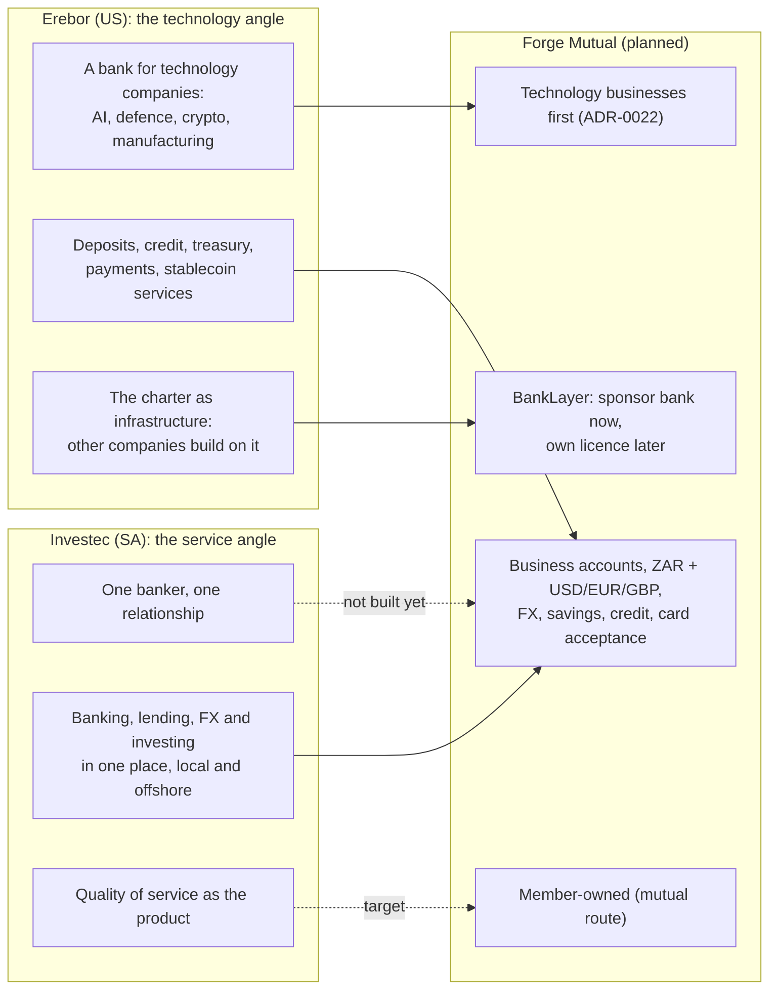

# Our bank model: Erebor for the technology, Investec for the service

> **DRAFT, owner's strategy note.** Forge Mutual borrows ideas from two banks and copies neither. This page says
> which ideas, from where, how far we have taken them, and where we deliberately differ. Forge is **not a licensed
> bank**, has no customers, and is not connected to either institution. Facts about Erebor and Investec come from
> their public pages and press coverage (linked at the end); they were not checked with either bank, and both change.
> Anything about what Forge has built is checked against this repository.

## In one picture

## What we take from Erebor (the technology angle)

Erebor is a US national bank, chartered in 2025, built for companies in AI, defence, crypto and manufacturing. It
offers deposits, credit, treasury management and payments, plans stablecoin services, and lets other companies build on
its charter.

| Idea | What it means for Forge | Where we are |
|---|---|---|
| **A bank that starts with technology companies** | Our first customers are technology businesses and their founders, not the general public (ADR-0022). The front door, the product order and the risk appetite follow from that. | Built into the product choices; sector appetite (ADR-0012) still to be decided by the owner. |
| **Software-first operations** | Everything is an API and a workflow: onboarding, KYC, payments, FX, reconciliation. A ledger on TigerBeetle, Temporal workflows, an audit log that cannot be edited, and thresholds as data. | Built and tested on the local stack (`docs/ARCHITECTURE.md`). |
| **Treasury for companies, not only accounts** | Multi-currency accounts, FX with a disclosed spread, bulk payouts, merchant acquiring, savings and notice deposits, and a prudential view (capital, liquidity, concentration). | Built; each product is off in production until a licence decision approves it (`pkg/licence`). |
| **Lending that reads our own data** | Overdrafts, working capital and revenue-based financing, decided from the cash flow we can see in the customer's accounts. | Built (`services/bank/lending-service`); needs credit policy, NCA registration and a bureau before use. |
| **The charter as infrastructure** | `BankLayer` hides who holds the licence. Today a sponsor bank holds it and Forge sits on its rails; later Forge holds its own licence, and the rest of the code does not change. | Built as an interface, a simulator and a contract suite. No sponsor chosen. |
| **Crypto-friendly, but regulated** | We bank licensed crypto businesses. | Policy only (see "Where we differ"). |
| **A front door that looks like a modern product** | The apply flow and public pages take their look from erebor.bank's restraint (light, plain, one accent colour); the sygnia.co.za site was used for the later restyle. Look and feel only: no text, images or marks were copied. | Built (`apps/web`). |

## What we take from Investec (the service angle)

Investec is a South African banking and wealth group. Its private bank gives each client a dedicated banker, a 24/7
support centre, local and offshore banking, investment advice, estate and tax planning, and travel and lifestyle
benefits; one page cites a qualifying income of about R800 000 a year (indicative, and changes).

| Idea | What it means for Forge | Where we are |
|---|---|---|
| **Everything in one place** | One login for rand accounts, foreign-currency accounts, FX, savings, credit and card acceptance, with a single view of what the customer owns across them. | Built: accounts, FX, deposits, lending, acquiring, consolidated view and a single customer view. |
| **Local and offshore together** | USD, EUR and GBP accounts at a partner bank, FX against the rand, inbound payments recorded for SARB reporting, and a per-person annual foreign allowance. | Built; needs an authorised-dealer arrangement and the SARB reporting channel. |
| **Credit as part of the relationship** | Statements, arrears tracking and default notices (NCA s.108 and s.129) in the same app as the account. | Built; legal review of the wording needed. |
| **Service as the differentiator** | A named person who knows the customer, fast answers, complaints handled properly. | **Not built.** There is no relationship-manager role in the roster and no service model yet; see "Gaps". |
| **Tiers by customer** | KYC tiers and limits by tier (thresholds 10 and 11) rather than one product for everyone. | Built as data; the values are placeholders. |

## Where we differ, on purpose

| | Erebor | Investec | **Forge Mutual** |
|---|---|---|---|
| Ownership | Shareholders | Listed group | **Depositor-members** (mutual bank planned; bank kept open): `docs/governance/LEGAL_FORMS.md` |
| Home market | United States | South Africa and UK | South Africa |
| Customers | Technology companies, high-net-worth | Affluent individuals, business, corporates | Technology businesses and their founders first |
| Crypto | Plans to hold crypto on its own balance sheet for stablecoin services and fees (per its charter filing) | Not the core offer | **No crypto on our balance sheet** until a separate licence decision. Banks FSCA-licensed crypto businesses only, with enhanced checks (risk appetite worksheet, rows 15 to 17). |
| Stablecoins | A stated focus | Not the core offer | **Not built.** Tokenised deposits are a designed capability (`BankLayer` capabilities), switched off. |
| Wealth management | Limited | Core | **Not planned.** We do not give investment, estate or tax advice. |
| Deposit protection | FDIC-insured | Deposit insurance (South Africa) | Deposit insurance reporting is designed; applies only once licensed. |
| Status | Chartered and operating | Operating | **Pre-licence**, sponsor-bank route first |

## Gaps against the model

Honest list of what the two banks do that Forge does not yet:

1. **Relationship managers: standard written, no one hired.** Seat R37 and `docs/governance/SERVICE_STANDARD.md`; the client
   record, queue and reporting it needs are not built.
2. **Card issuing: built, not usable.** `services/bank/card-service` issues virtual debit cards on a customer's account
   and approves each purchase against the ledger in real time (holds, limits, clearing, reversal, refund), tested against
   a processor simulator. It needs a card programme manager or sponsor, a processor, and the sponsor's and regulator's
   agreement before it can be switched on, and it is not yet reachable from the customer app.
3. **Investments and wealth: a referral partnership, not a product.** `docs/products/WEALTH_PARTNERSHIP.md` sets out the
   introducer model, consent and a recommendation to wait until after the pilot. Nothing built.
4. **Stablecoin or on-chain settlement: decision memo and invariants written, no service.** The architecture forbids token
   assets in the bank ledger without an own licence, and puts digital assets in a separate entity. `docs/products/DIGITAL_ASSETS.md`
   sets out three options and recommends a licensed-partner route first; `pkg/digitalassets` holds the tested reserve,
   wallet and travel-rule checks any future build must pass.
5. **No branches, ATMs or cash, by design.** `docs/regulatory/policies/cash-policy.md` says so and says what must be true
   before that changes (register row FIC-07).
6. **No licence, no sponsor, no customers.** Cannot be built. Everything above is software and documents until that changes;
   see `docs/governance/SPONSOR_BANK_PITCH.md` and `docs/governance/LAWYER_BRIEF.md` for the route.

## Why this model

- **Erebor shows there is demand** for a bank that understands technology companies, and that software can be the
  bank's operating model. Its regulatory route (a US national charter) does not transfer to South Africa; ours is a
  sponsor bank first, then a mutual or bank registration.
- **Investec shows what a premium relationship looks like** in the South African market and what clients will pay for.
  Our cost base is software, not branches, so a smaller team may be able to serve fewer, better-understood customers.
- **The mutual form is our own idea**: members own the bank, so surplus goes back to them. It suits founders' networks,
  co-operatives and microfinance institutions, and it is the part neither bank has.

## Sources

- [OCC: conditional approval of the Erebor Bank charter](https://www.occ.gov/news-issuances/news-releases/2025/nr-occ-2025-101.html)
- [FDIC: Erebor Bank deposit insurance approval](https://fdic.gov/news/press-releases/2025/fdic-approves-deposit-insurance-application-erebor-bank-na-columbus-ohio)
- [Banking Dive: Erebor receives national bank charter](https://bankingdive.com/news/erebor-bank-receives-national-bank-charter/811724/)
- [Investec: why become a Private Banking client](https://www.investec.com/en_za/banking/private-bank-account/discover-the-benefits-of-private-banking.html)
- [Investec: private banking for individuals factsheet](https://www.investec.com/content/dam/south-africa/myself/private-banking/factsheets/private_banking_for_individuals_factsheet.pdf)

Erebor's product scope in this page comes from its charter filing as reported by the press, not from the OCC document
itself; check the primary source before relying on a detail.
