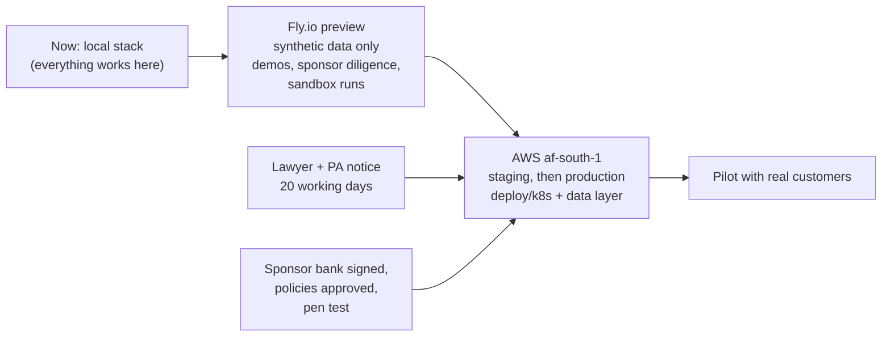

# Hosting: Fly.io for the preview, AWS for production

> **DRAFT, owner's direction of 2026-11-18 and later (Tebogo Mvelase): run on Fly.io for now, ultimately on AWS.**
> A direction, not a final decision: ADR-0002 closes only after the checks below. Everything about Fly.io and AWS
> here is from general knowledge and the Fly MCP guide, not tested by us; each point marked VERIFY needs checking.

## The rule that makes both safe

**Fly.io holds no real customer data and no real money.** It hosts the pre-licence preview: the local stack running
for demonstrations, sponsor-bank due diligence and the first sandbox runs against WorkOS and Didit, with synthetic
people only. Forge has no licence, so no customer money may be held anywhere anyway (`README.md`, Launch readiness).

The day a real customer's personal information goes in, the hosting becomes a material outsourcing and cloud
arrangement under Directive 3/2018, Guidance Note 5/2014 and Joint Standard 2 of 2024: due diligence
(`provider-due-diligence-procedure.md`), a contract meeting `provider-contract-schedule.md`, an entry in the
outsourcing register, and notice to the Prudential Authority at least 20 working days before it starts
(`scripts/check-outsourcing.py` computes the date). That day should be **AWS**, not Fly.io.

## Why AWS is the destination (VERIFY each)

- A South African region (Cape Town, `af-south-1`) keeps personal data in South Africa, which the data classes require
  for several kinds of data (`docs/regulatory/data-classes.csv`) and which POPIA and Directive 3 reward.
- Managed Kubernetes (EKS), Postgres (RDS or Aurora), Kafka (MSK), a secret store and a certificate authority exist
  as services, and AWS publishes independent audit reports a sponsor bank will recognise.
- Our manifests (`deploy/k8s`) are Kubernetes, so they apply to EKS with the 9 placeholders filled
  (`deploy/k8s/README.md`).

## What Fly.io is good for now

- Cheap, quick, close to the stack we already run: containers as Machines, private networking between apps, volumes,
  and a managed Postgres.
- A throwaway place to prove that the services start, find each other and pass the journeys somewhere that is not a
  laptop, before AWS is paid for.

## What Fly.io is not (VERIFY each)

- **Not the deployment target of `deploy/k8s`.** Fly runs apps and Machines, described by a `fly.toml` per app, not
  our Kubernetes manifests. Moving between them is a re-description of the same containers, not a rebuild.
- **Not a place for TigerBeetle in production.** It needs `io_uring`, dedicated hosts and a six-replica cluster;
  whether Fly's Machines allow `io_uring` must be tested before relying on it, even for the preview. Fallback: run the
  ledger on the in-memory model for the preview only (`LEDGER_STORE=memory`), which production refuses.
- **No managed Kafka or Temporal.** Either run them as Machines, or use hosted ones; neither is verified here.
- **A South African region** may or may not be offered; if not, the preview must stay synthetic-only.

## What this session can and cannot do on Fly.io today

The Fly connection in this session is signed in to your own Fly organisation, `tebogo-mvelase`, as admin, but its
grant is narrow:

| Can do | Cannot do |
|---|---|
| Create and read **Managed Postgres** clusters and databases; run read-only SQL | Create apps, deploy, or manage Machines, volumes or app secrets (no such scopes; the guide says deployment workflows and app creation are not included) |
| Read organisation and billing context | Anything outside this organisation |
| Create up to **3 Sprites** named with the prefix `a-card` (a sandbox product, not a place to run a bank) | Create a Sprite with any other name |

So the **database layer** could be created from here; **deploying the services** cannot, without something more:

1. **A Fly deploy token** for a Forge-only app group, given through the secure credential form (never pasted in chat),
   and the environment allowed to reach `api.fly.io` and `registry.fly.io` so `flyctl` can push images. This session
   has Docker, so it can build the images (`deploy/docker/service.Dockerfile`).
2. **Your say-so on cost**: every Machine and Postgres cluster bills.

**One question to settle first.** The Fly grant is named for A-CARD (Sprites prefix `a-card`), although the
organisation is yours. You ruled out A-CARD accounts for this project. Confirm whether `tebogo-mvelase` is the
organisation you want Forge in, or whether you will create a separate Forge organisation.

## WorkOS and Didit

| | State | What it means |
|---|---|---|
| WorkOS connector in this session | Connected, but to the **A-CARD** team (signed in as the A-CARD address, projects FORGE, OpenFireblocks, Neo-Lloyds, OPEN PRIVY, A-CARD's Project). It already holds a project called "FORGE". | **Not used.** Your decision was a new WorkOS account on the Forge email. Nothing was read beyond who the connection is. |
| Didit connector | Reaches only A-CARD (recorded earlier). | **Not used**, not even to list. |
| `workos-forge-mutual` and `didit` in `.mcp.json` | Cannot connect: the session's network refuses `mcp.workos.com` and `mcp.didit.me`. | Needs the hosts allowed *and* your sign-in; see below. |

What you do, in this order:

1. Create the **WorkOS** and **Didit** accounts on the Forge email, if not done (`docs/PROVIDERS.md` has the steps).
2. At [claude.ai/customize/connectors](https://claude.ai/customize/connectors), add a connector for each, signing in
   with the **Forge** accounts, not A-CARD. If your claude.ai account already holds the A-CARD ones under the same name,
   remove or disable those first, or add the new ones under different names (for example "WorkOS Forge"). VERIFY that
   two connectors for one server can coexist.
3. **Start a new session** (connectors are read when a session starts). I will first confirm which organisation each
   one reaches, and stop if it is A-CARD.
4. Say yes to allowing the two hosts in this environment's network settings if the `.mcp.json` route is wanted; the
   claude.ai connector route needs no host change.

Then the work waiting on them starts: configure WorkOS AuthKit, build the Didit KYC and KYB workflows in its sandbox,
register the webhook, and run an onboarding end to end with simulated outcomes.

## AWS

The AWS connection in this session needs you to sign in again (`/mcp`, or the connector settings), and I do not know
which AWS account it reaches. Once it is back I will read who the caller is (read-only) and stop if it is not an account
you intend for Forge. Nothing is created in AWS without your say-so; a Terraform description of the landing zone
(accounts, `af-south-1` network, EKS, RDS, MSK, KMS, a private CA) is the first piece of work, and it can be written and
checked on paper before any account exists.

## Plan

| Step | Who | Needs |
|---|---|---|
| Confirm the Fly organisation, and the cost ceiling | You | A decision |
| Fly deploy token; host allowlist | You (credential form, environment settings) | The token, approval of the settings change |
| Build images; create preview apps and Postgres | Me | The two above |
| Reconnect AWS; confirm the account | You, then me | Sign-in |
| Terraform for the AWS landing zone, on paper | Me | Nothing, can start now |
| PA notice for AWS production hosting | CCO (vacant), lawyer | Appointments; a start date |
