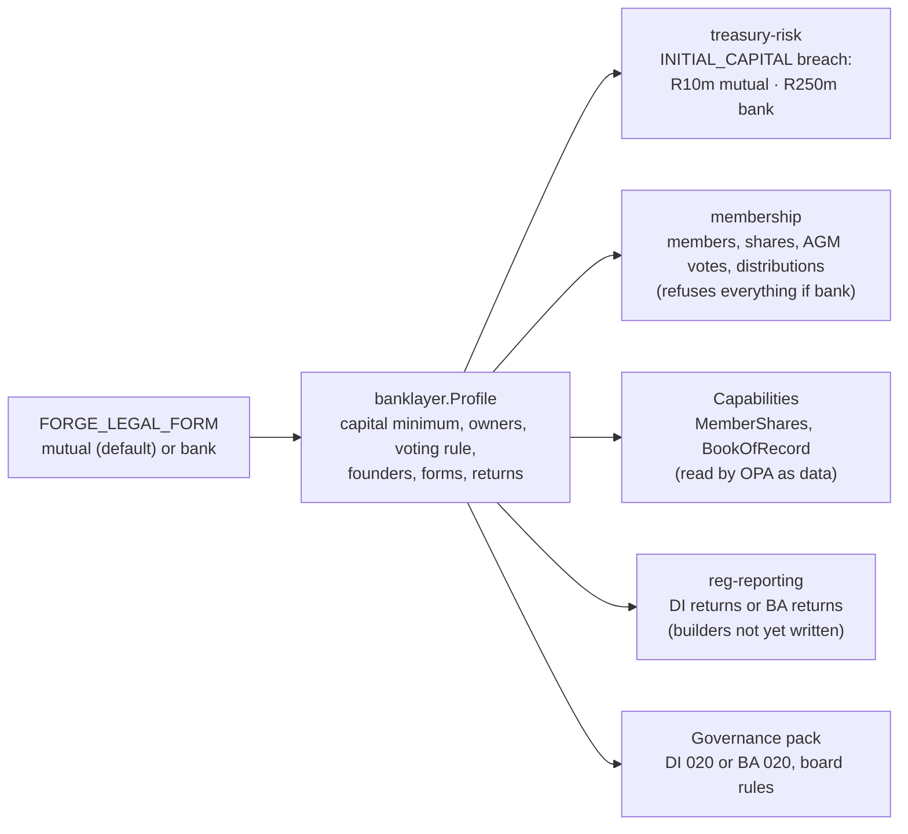
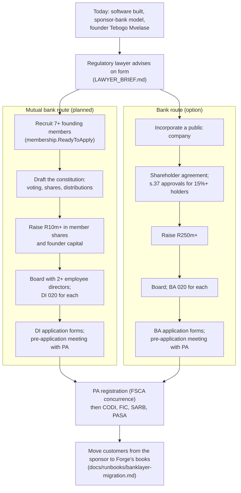

# Two legal forms: mutual bank (planned) and bank (kept open)

> **DRAFT.** Owner's direction on 2026-11-18 (Tebogo Mvelase): plan for a **mutual bank**, and keep the **bank**
> route ready in case capital, investors or the regulator point that way. Not a final decision: ADR-0020 stays open
> until the regulatory lawyer has advised (see [`LAWYER_BRIEF.md`](LAWYER_BRIEF.md)). Every figure is from the
> regulatory register and must be confirmed against the current law.

## How both are kept open

Nothing in the software branches on the legal form. The differences are data in one place,
[`pkg/banklayer/legalform.go`](../../pkg/banklayer/legalform.go), and every service reads them from there:

Switching from one to the other is a configuration change plus the legal work; no code changes.

## Side by side

| | Mutual bank (planned) | Bank (option) |
|---|---|---|
| Law | Mutual Banks Act 124 of 1993 | Banks Act 94 of 1990, Companies Act 71 of 2008 |
| Owned by | Depositor-members, who hold member shares | Shareholders of a public company |
| Minimum initial capital | **R10 million** (verify current figure) | **R250 million** (verify) |
| Founders | At least **7**, signing the founding documents | One or more shareholders |
| Voting | One member, one vote (PROPOSED; the constitution decides) | By shares |
| Ownership approval | Members' rules in the constitution | PA permission above 15% (Banks Act s.37; verify thresholds) |
| Employee directors | At least **2** (MR-03) | No fixed minimum; King IV and PA expectations |
| Fit and proper form | DI 020 | BA 020 |
| Application forms | DI 100, 110, 200, 300, 400, 430, 700 | BA 100, 110, 120, 130, 300, 350, 700 |
| Returns | DI 100 to DI 900 (about 18) | BA 100 to BA 950 (about 19) |
| Venture capital | No: cannot easily raise outside equity or be sold | Yes |
| Surplus | Back to members as rebates, better rates or dividends | To shareholders |
| Fit for Forge | Member ownership, MFIs and co-operatives as members, stokvels, lower capital | Faster growth, investors, exit |
| In the code | `MemberShares = true`; membership module active | `MemberShares = false`; membership refuses |

## Path for each

## What changes in the governance pack

- **Mutual:** the general meeting of members elects directors; the membership module keeps the register, shares and
  votes; distributions need board approval (maker-checker in code); seat R36, member relations, is needed.
- **Bank:** the shareholder register replaces the member register; the ownership policy applies the s.37 approvals;
  R36 is not needed.
- Everything else (board, committees, three lines of defence, policies, risk appetite) is the same for both.

## What is built and what is not

| Item | Mutual | Bank |
|---|---|---|
| Legal-form profile and selection (`FORGE_LEGAL_FORM`) | Built, tested | Built, tested |
| Minimum capital breach in the prudential report | Built, tested | Built, tested |
| Member register, shares (issue, redeem with capital check), meetings, one-member-one-vote, quorum and majorities, distributions to the cent | Built, tested against Postgres; not yet wired to a running service or the ledger (8001/8002, transfer 80) | Not needed |
| Shareholder register | Not needed | Kept by the company secretary (a document, not code) |
| Return builders (DI or BA) | Not built | Not built |
| Application form builders | Not built | Not built |
