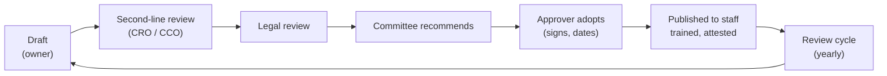

# Policy framework

> Generated from [`policies.csv`](policies.csv) by `scripts/build-governance.py`. Every policy is a DRAFT; none is approved.

Policies sit under the risk management framework and the risk appetite statement (see the hierarchy in
[`STRUCTURE.md`](STRUCTURE.md#5-policy-hierarchy)). Each has one owner who keeps it current, one approver, and a
review cycle. A policy takes effect only when its approver signs the sign-off block and the date is recorded.

## Lifecycle

## Governance

| Policy | Owner | Approver | Review | Register rows | Status |
|---|---|---|---|---|---|
| [Board charter](../regulatory/policies/board-charter.md) | Company Secretary (R17, VACANT) | Board | Yearly | LIC-06, BR-02, MR-03, MR-02, LIC-07 | Draft 0.1 |
| [Terms of reference for board and management committees](../regulatory/policies/committee-terms-of-reference.md) | Company Secretary (R17, VACANT) | Board | Yearly | BR-02, BR-05, LIC-13, JS1-03 | Draft 0.1 |
| [Conflicts of interest and related-party policy](../regulatory/policies/conflicts-of-interest-policy.md) | Company Secretary (R17, VACANT) | Board | Yearly | LIC-06, BR-02 | Draft 0.1 |
| [Code of conduct and ethics](../regulatory/policies/code-of-conduct.md) | Head of People (R20, VACANT) | Board, on Social and Ethics Committee recommendation | Yearly | LIC-06 | Draft 0.1 |
| [Whistleblowing policy](../regulatory/policies/whistleblowing-policy.md) | Chief Compliance Officer (R04, VACANT) | Audit Committee | Yearly | BR-02 | Draft 0.1 |
| [Remuneration policy](../regulatory/policies/remuneration-policy.md) | Head of People (R20, VACANT) | Board, on Remuneration Committee recommendation | Yearly | BR-02 | Draft 0.1 |
| [Shareholders, significant ownership and founders](../regulatory/policies/shareholder-and-significant-ownership-policy.md) | Company Secretary (R17, VACANT) | Board | Yearly | LIC-05, LIC-07, LIC-02 | Draft 0.1 |
| [Fit-and-proper procedure](../regulatory/policies/fit-and-proper-procedure.md) | Company Secretary (R17, VACANT) | Board, on Nominations Committee recommendation | Yearly | LIC-05, LIC-06 | Draft |
| [Staff, contractor and provider screening (Joint Standard 1 of 2023; FICA s.42A)](../regulatory/policies/staff-screening.md) | Head of People (R20, VACANT) | Executive committee | Yearly | FIC-10, JS1-06 | Draft |
| [Cyber awareness and training plan](../regulatory/policies/training-plan.md) | Head of People (R20, VACANT) | Executive committee | Yearly | JS2-10 | Draft |
| [Licence application plan](../regulatory/policies/licence-application-plan.md) | Founder and CEO: Tebogo Mvelase (R01) | Board (once constituted) | Monthly until submitted | LIC-01, LIC-02, LIC-05, LIC-06, LIC-07, LIC-10, LIC-11, LIC-12, LIC-13, LIC-14, LIC-16, LIC-17 | Draft 0.1 |
| [Business plan outline (application pack)](../regulatory/policies/business-plan-outline.md) | Founder and CEO: Tebogo Mvelase (R01) | Board | Yearly | LIC-14 | Draft |
| [Naming, marketing and public statements policy](../regulatory/policies/naming-and-marketing-policy.md) | Chief Compliance Officer (R04, VACANT) | Executive committee | Yearly | LIC-17 | Draft 0.1 |

## Risk and capital

| Policy | Owner | Approver | Review | Register rows | Status |
|---|---|---|---|---|---|
| [Risk management framework](../regulatory/policies/risk-management-framework.md) | Chief Risk Officer (R02, VACANT) | Board, on Risk and Capital Management Committee recommendation | Yearly | BR-02, MR-01, LIC-13 | Draft 0.1 |
| [Risk appetite statement](../regulatory/policies/risk-appetite-statement.md) | Chief Risk Officer (R02, VACANT) | Board | Yearly, and on any material change | BR-02, MR-01, LIC-13, LIC-12 | Draft 0.1 |
| [Risk register (initial, complete list)](../regulatory/policies/risk-register.md) | Chief Risk Officer (R02, VACANT) | Risk and Capital Management Committee | Yearly |  | Draft |
| [Capital management policy and ICAAP](../regulatory/policies/capital-management-policy.md) | Chief Financial Officer (R03, VACANT) | Board | Yearly | LIC-02, LIC-13, BR-02, BR-07 | Draft 0.1 |
| [Credit risk policy](../regulatory/policies/credit-risk-policy.md) | Head of Credit (R15, VACANT) | Board, on Risk Committee recommendation | Yearly | LIC-13, BR-02, NCA-01, NCA-05 | Draft 0.1 |
| [Market and interest rate risk policy](../regulatory/policies/market-and-interest-rate-risk-policy.md) | Head of Treasury (R13, VACANT) | Board, on ALCO and Risk Committee recommendation | Yearly | LIC-13, MR-01, EXC-02 | Draft 0.1 |
| [Operational risk policy](../regulatory/policies/operational-risk-policy.md) | Chief Risk Officer (R02, VACANT) | Board, on Risk Committee recommendation | Yearly | LIC-13, BR-02, MR-01 | Draft 0.1 |
| [Deposit concentration and liquidity limits policy](../regulatory/policies/concentration-policy.md) | Head of Treasury (R13, VACANT) | Board, on ALCO recommendation | Yearly | BR-04 | Draft |
| [Liquidity risk framework and contingency funding plan (Banks Act regulations)](../regulatory/policies/liquidity-and-contingency-funding-plan.md) | Head of Treasury (R13, VACANT) | Board, on ALCO recommendation | Yearly | BR-04, LIC-04 | Draft |
| [Business continuity, disaster recovery and recovery plan](../regulatory/policies/recovery-plan.md) | Chief Risk Officer (R02, VACANT) | Board | Yearly | BR-04, JS2-12, JS2-13 | Draft |
| [New product approval policy](../regulatory/policies/new-product-approval-policy.md) | Head of Product (R18, VACANT) | Board | Yearly | BR-02, LIC-13 | Draft 0.1 |

## Finance and reporting

| Policy | Owner | Approver | Review | Register rows | Status |
|---|---|---|---|---|---|
| [Internal control over financial reporting](../regulatory/policies/internal-control-over-financial-reporting.md) | Chief Financial Officer (R03, VACANT) | Audit Committee | Yearly | MR-02, RET-01, BR-07 | Draft 0.1 |
| [Regulatory returns policy](../regulatory/policies/regulatory-reporting-policy.md) | Chief Financial Officer (R03, VACANT) | Audit Committee | Yearly | BR-07, MR-05, MR-06, RET-01, LIC-11 | Draft 0.1 |

## Compliance, financial crime and conduct

| Policy | Owner | Approver | Review | Register rows | Status |
|---|---|---|---|---|---|
| [Compliance charter](../regulatory/policies/compliance-charter.md) | Chief Compliance Officer (R04, VACANT) | Board, on Audit Committee recommendation | Yearly | BR-02, FIC-10, LIC-16 | Draft 0.1 |
| [Risk Management and Compliance Programme (FICA s.42)](../regulatory/policies/rmcp.md) | Money Laundering Reporting Officer (R06, VACANT) | Board | Yearly | FIC-01, FIC-10 | Draft |
| [Cash threshold reporting procedure](../regulatory/policies/cash-threshold-reporting-procedure.md) | Money Laundering Reporting Officer (R06, VACANT) | Financial Crime Committee | Yearly | FIC-07 | Draft 0.1 |
| [Complaints and treating customers fairly policy](../regulatory/policies/complaints-and-fair-treatment-policy.md) | Head of Customer Service and Complaints (R19, VACANT) | Board, on Social and Ethics Committee recommendation | Yearly | BR-02 | Draft 0.1 |
| [Cash policy](../regulatory/policies/cash-policy.md) | Money Laundering Reporting Officer (R06, VACANT) | Board, on Risk and Capital Management Committee recommendation | Yearly, and before any cash channel is added | FIC-07, FIC-10 | Draft 0.1 |

## Assurance

| Policy | Owner | Approver | Review | Register rows | Status |
|---|---|---|---|---|---|
| [Internal audit charter](../regulatory/policies/internal-audit-charter.md) | Head of Internal Audit (R11, VACANT) | Audit Committee | Yearly | BR-05, LIC-14 | Draft 0.1 |

## Technology, cyber and resilience

| Policy | Owner | Approver | Review | Register rows | Status |
|---|---|---|---|---|---|
| [IT governance and risk management framework](../regulatory/policies/it-risk-management-framework.md) | Head of IT Risk (R14, VACANT) | Board, on IT and Cyber Committee recommendation | Yearly | JS1-03, JS1-12, GAP-01, LIC-10 | Draft 0.1 |
| [IT strategy (Joint Standard 1 of 2023)](../regulatory/policies/it-strategy.md) | Chief Technology Officer (R10, VACANT) | Board, on IT and Cyber Committee recommendation | Yearly | JS1-01 | Draft |
| [IT service management: change, release, incident, problem and capacity (Joint Standard 1 of 2023)](../regulatory/policies/it-service-management.md) | Chief Technology Officer (R10, VACANT) | Executive committee | Yearly | JS1-07 | Draft |
| [IT programme and project framework (Joint Standard 1 of 2023)](../regulatory/policies/it-project-framework.md) | Chief Technology Officer (R10, VACANT) | Executive committee | Yearly | JS1-10 | Draft |
| [Cyber and information security strategy and framework](../regulatory/policies/cyber-strategy.md) | Chief Information Security Officer (R12, VACANT) | Board, on IT and Cyber Committee recommendation | Yearly | JS2-01, JS2-17 | Draft |
| [Access control and privileged access policy](../regulatory/policies/access-control-policy.md) | Chief Information Security Officer (R12, VACANT) | IT and Cyber Committee | Yearly | JS2-03, JS2-04, JS2-05 | Draft |
| [Cryptographic key management policy](../regulatory/policies/key-management-policy.md) | Chief Information Security Officer (R12, VACANT) | IT and Cyber Committee | Yearly | JS2-09 | Draft |
| [Secure development and open-source policy](../regulatory/policies/secure-development-policy.md) | Chief Technology Officer (R10, VACANT) | IT and Cyber Committee | Yearly | JS2-07, JS2-17 | Draft |
| [Secure configuration standard (Joint Standard 2 of 2024: configuration and patching)](../regulatory/policies/secure-configuration-standard.md) | Chief Information Security Officer (R12, VACANT) | Change Advisory Board | Yearly | JS2-07, JS2-17 | Draft |
| [Threat intelligence and security testing policy](../regulatory/policies/threat-intelligence-and-security-testing-policy.md) | Chief Information Security Officer (R12, VACANT) | IT and Cyber Committee | Yearly | JS2-15, JS2-16, G4-01, G4-02 | Draft 0.1 |
| [Incident response plan](../regulatory/policies/incident-response-plan.md) | Chief Information Security Officer (R12, VACANT) | IT and Cyber Committee | Yearly | JN-01, JN-02, JN-03, JS2-14, JS2-18 | Draft |
| [Regulatory incident notification procedure](../regulatory/policies/regulatory-incident-notification-procedure.md) | Chief Information Security Officer (R12, VACANT) | Executive committee | Yearly | JS2-18, JN-04, POP-06 | Draft 0.1 |
| [Business continuity and disaster recovery policy](../regulatory/policies/business-continuity-and-disaster-recovery-policy.md) | Business Continuity Manager (R28, VACANT) | Board, on IT and Cyber Committee recommendation | Yearly | G4-02, JS1-12, OUT-05 | Draft 0.1 |
| [Business impact analysis](../regulatory/policies/business-impact-analysis.md) | Business Continuity Manager (R28, VACANT) | IT and Cyber Committee | Yearly | G4-02, JS1-12, OUT-05 | Draft 0.1 |

## Data and privacy

| Policy | Owner | Approver | Review | Register rows | Status |
|---|---|---|---|---|---|
| [Data strategy and classification policy](../regulatory/policies/data-strategy.md) | Head of Data and Data Protection (R23, VACANT) | Board | Yearly | JS2-02, JS2-06 | Draft |
| [Data retention schedule (POPIA s.14; FICA s.22, s.23)](../regulatory/policies/data-retention-schedule.md) | Head of Data and Data Protection (R23, VACANT) | Data Governance Council | Yearly | FIC-05, POP-03 | Draft |
| [Privacy notice (POPIA s.18): customer-facing draft](../regulatory/policies/privacy-notice.md) | Information Officer: Tebogo Mvelase (R27) | Executive committee | Yearly | POP-01, POP-08 | Draft |
| [POPIA compliance framework and PAIA manual outline](../regulatory/policies/popia-compliance-framework.md) | Information Officer: Tebogo Mvelase (R27); Deputy VACANT | Board | Yearly | POP-01, POP-02, POP-08 | Draft 0.1 |

## Third parties

| Policy | Owner | Approver | Review | Register rows | Status |
|---|---|---|---|---|---|
| [Outsourcing and third-party policy](../regulatory/policies/outsourcing-policy.md) | Chief Operating Officer (R08, VACANT) | Board | Yearly | D3-01, D3-06, OUT-01, OUT-05 | Draft |
| [Cloud computing and offshoring of data policy](../regulatory/policies/cloud-and-offshoring-policy.md) | Chief Technology Officer (R10, VACANT) | Board, on IT and Cyber Committee recommendation | Yearly | D3-02, D3-03, D3-05, D3-07, OUT-01, POP-08 | Draft 0.1 |
| [Provider due diligence procedure](../regulatory/policies/provider-due-diligence-procedure.md) | Chief Operating Officer (R08, VACANT) | Executive committee | Yearly | D3-03, OUT-03, OUT-06, JN-04, D3-07 | Draft 0.1 |
| [Exit plans for providers (Directive 3 of 2018; Guidance Note 5 of 2014)](../regulatory/policies/exit-plans.md) | Chief Operating Officer (R08, VACANT) | Executive committee | Yearly | D3-06 | Draft |
| [Provider contract schedule: minimum clauses](../regulatory/policies/provider-contract-schedule.md) | Head of Legal (R26, VACANT) | Board, on Audit Committee recommendation | Yearly | D3-05, D3-07, OUT-03, OUT-06, JN-04, POP-08 | Draft 0.1 |

