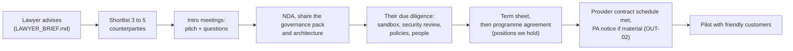

# Sponsor bank: pitch, questions and checklist

> **DRAFT for Tebogo Mvelase to adapt. Revised 2026-11-24 after a review against `CONSTITUTION_DRAFT.md` and `BUSINESS_PLAN_DRAFT.md`.** A sponsor
> bank is the fastest legal route to customers: it holds the licence and the deposits, and Forge sits on its rails (`BankLayer`,
> `docs/ARCHITECTURE.md` section 5.2). Nothing here has been sent. I can't confirm which South African banks offer such arrangements, or on what
> terms; the shortlist at the end is a list of kinds of counterparty to approach, to be checked by you and the lawyer (`LAWYER_BRIEF.md`).
>
> **Before this goes anywhere:** the lawyer must confirm the wording marked ⚖ below (how Forge may describe itself before authorisation, LIC-17) and
> review the positions in "Positions we hold". Do not send the illustrative pro forma as a forecast.

## The pitch in one page

**Who we are.** The contracting company today is **MYFORGE (Pty) Ltd**, which builds and runs the Forge platform; its founder is Tebogo Mvelase. MYFORGE
intends to support the formation of a **proposed mutual bank, not yet registered** ⚖ (with a bank registration as the alternative; `LEGAL_FORMS.md`). **No
bank, mutual bank or other regulated entity exists yet, and MYFORGE is not licensed.** Until a licence is granted we would operate as a **programme on
your licence**: you hold the deposits and carry the regulatory relationship; MYFORGE builds and runs the customer experience. We do not use "bank" in our
public name and will not until the Prudential Authority authorises it.

**Who we serve.** Technology businesses and their founders: companies that need rand and foreign-currency accounts, payments, FX and treasury, through
software (`BANK_MODEL.md`). The wider product set (savings, credit, card acceptance, cards) is built but **switched off**: each would be a separate
decision with you and with the regulator, and none is assumed in this approach.

**What we bring you.**

1. **A working platform, tested only against simulators.** Accounts, payments, reconciliation, multi-currency, FX and the workspace run end to end on a
   local stack, and the software gate passes. **Every outside party is simulated**: no sponsor bank, no payment rail, no live identity provider and no
   real customer has been connected. There is no production hosting. The code is real; the integrations are not yet proven.
2. **Controls you can inspect.** Every balance is reconciled to bank statements; payments are held while a reconciliation break is open; limits and monitoring
   rules are data owned by named people; every decision goes to an append-only audit log; customers are re-screened daily and a match opens a critical
   case and freezes the customer. **The screening list is a development fixture of one name.** The sanctions-list source and licence are undecided
   (`docs/SANCTIONS_SOURCES.md`), so this control is built but not live-grade.
3. **A governance pack with an honest status:** structure, 37 seats, 58 draft policies and a 114-line regulatory register. **None of the policies is
   approved and 36 of the 37 seats are vacant.** We expect you to find gaps; we would rather you find them than a regulator.
4. **A way out.** `BankLayer` isolates every route-specific detail so that moving to our own licence later is a migration, not a rebuild (**the
   migration runbook is not yet written**).

**What we ask of you.** A sponsor sandbox and wire formats; a programme agreement; your onboarding standards; and a view on which products you would
carry. Start with the core: ZAR and USD accounts, payments and FX.

**What we are not.** Licensed, funded, or staffed beyond the founder. We have no capital raised, no board, no approved policy, no signed provider, no
penetration test (SF-001), no production environment and no customers. Every external connection is a simulator today. Say all of this first; they will
ask, and each point is also in the readiness table below.

## Things to disclose up front (so they do not look hidden)

| Topic | What is true | Why a sponsor cares |
|---|---|---|
| Third-party offers | A layer can introduce customers to investment and crypto-asset products that a licensed third party provides. It is **off by default and off in production** until a named decision approves it, no provider is chosen, and every offer states it is provided, licensed and monitored by the third party, not by Forge or you. | Conduct and reputational risk to the programme; holding-out risk; FAIS and CASP licensing of the provider |
| Referral fees | Forge may receive a referral fee from a provider, set per offer and stated to the customer in the statement they acknowledge; it is booked only against a bank receipt, once, within the stated cap, by two people. No fee is earned today. | Conflict of interest and disclosure; where the money lands (it would reach Forge through you) |
| Customer names to providers | If a customer consents, **their name only** is sent to the provider they chose, signed and over https, and never anything else; withdrawing stops anything unsent but cannot recall what was sent. | POPIA, your own data-sharing and outsourcing rules, whether your customer data may be shared at all |
| Sign-in and identity providers | WorkOS (sign-in, likely US processing) and Didit (identity checks, location unconfirmed) are the chosen providers. **Neither account exists yet and nothing has run against them**; the apps use development sign-in only. | Outsourcing, cross-border data, and whether you will allow our providers under your policy |
| Sanctions list | A one-name fixture today; a licensed source is undecided. | Your regulatory responsibility for screening under your licence |
| The contracting company | MYFORGE (Pty) Ltd, whose founder will also found the proposed mutual bank; MYFORGE would be the bank's main technology supplier. | Related-party and concentration risk, and who stands behind the contract |

## Positions we hold (confirm with the lawyer before the first meeting)

These protect the plan to apply for our own licence. A sponsor will not always accept all of them; we should know which we can give up and which we cannot.

1. **No exclusivity or non-compete that stops us applying for, or operating under, our own licence.** A clause that treats Forge as a competitor if it
   becomes a bank would block the application and is **not acceptable**. Accept a reasonable duty not to solicit your customers by improper means.
2. **The contract must be assignable (novated) to the future bank, or to a successor MYFORGE nominates, on notice and the Prudential Authority's approval**,
   without the sponsor being able to refuse or re-price it as a result.
3. **A defined exit:** return of data in an agreed format, orderly migration of customers to our own books, a transition period at the current price, and
   no termination by you on account of our application. Match this with the contract schedule in `docs/regulatory/policies/provider-contract-schedule.md`
   (incident notice within 4 hours, exit assistance, no termination on recovery or resolution).
4. **MYFORGE signs, not a pretend bank.** The agreement says in terms that MYFORGE is not licensed and does not hold customer money.
5. **Customers are portable.** On exit, customers can choose to move; we do not lock them in, and we do not take their money.
6. **No promise on capital or timing.** We do not give guarantees about when or whether we will be registered.
7. **Independent legal advice.** The lawyer who advises us does not act for you (`LAWYER_BRIEF.md`).

## Questions to ask them

| Topic | Question |
|---|---|
| Model | Do you offer a programme or banking-as-a-service arrangement for a pre-licence fintech? Are customers yours or ours, in the deposits and in the contract? |
| Contracting party | You would contract with MYFORGE (Pty) Ltd, an unlicensed technology company. What do you need from it and its founder: guarantees, capital, insurance, a director's undertaking? |
| Assignment | Will you agree that the contract can be novated to our own bank, or a successor, when and if we are registered? On what conditions? |
| Exclusivity | Is exclusivity or a non-compete a condition? We cannot agree to anything that stops us applying for our own licence. What is the narrowest restriction you need? |
| Eligibility | What do you need to see before a first meeting: capital, directors fit and proper, policies, a security review? We have none of these yet. |
| Controls | Whose KYC, sanctions screening and transaction monitoring count? May we use our own provider (Didit) under your policy? Which sanctions list do you require, and may we use yours? Who files STRs with the FIC? |
| Payments | EFT, RTC and PayShap access: through you, in what formats (VERIFY-SPONSOR), with what cut-offs and fees? |
| Foreign currency | Do you provide an authorised-dealer arrangement and SARB reporting, or do we need a separate one? |
| Deposits | Pooled account or sub-accounts per customer? How is deposit insurance treated? What is the customer-money protection if MYFORGE fails? |
| Credit | We are not registered as a credit provider and have no balance sheet. **Which, if any, credit products would you carry on your own licence and balance sheet, and which can we not offer at all until we are registered?** (We do not assume any.) |
| Third-party offers | May we show customers products from licensed third parties, under what disclosure, and may we receive a referral fee that reaches us through you? Or do you prohibit it? |
| Data and providers | May customer data flow to WorkOS (sign-in, likely US) and Didit (identity)? To a product provider with the customer's consent? Which of our providers do you treat as material outsourcing? |
| Economics | Fees, revenue share, minimum volumes, term, exclusivity, exit and notice. |
| Oversight | Audit rights, reporting we owe you, incident notice times (we propose 4 hours; `provider-contract-schedule.md`), your regulator notices. |
| Exit | Data return, customer migration to our own licence, transition price and period. We will not accept a non-compete. |

## What they will want from us, and where it is

| They will ask for | Where it is | Ready? |
|---|---|---|
| Business plan and projections | `docs/licence-application/BUSINESS_PLAN_DRAFT.md` (outline: `docs/regulatory/policies/business-plan-outline.md`) | Draft plan with **no real projections**; **do not share `docs/regulatory/proforma/` as a forecast** (illustrative, and it disagrees with the `CONTEXT.md` economics) |
| Legal form and constitution | `docs/licence-application/CONSTITUTION_DRAFT.md`, `LEGAL_FORMS.md` | Draft for the lawyer; ADR-0020 open; one founder named |
| Directors and key people | `docs/governance/ROLES.md`, `FIT_AND_PROPER_PACK.md` | Founder only; MLRO and risk and compliance heads **vacant** |
| Policies (AML, risk, outsourcing, security) | `docs/regulatory/policies/` | Drafts, none approved |
| RMCP (FICA risk management and compliance programme) | `docs/regulatory/policies/rmcp.md` | Draft |
| Sanctions screening | `docs/SANCTIONS_SOURCES.md` | Recommendation only; source and licence **not chosen**; screening runs on a one-name fixture |
| Security evidence | `docs/regulatory/security-findings.csv`, CI gate output | **No penetration test yet** (SF-001) |
| Architecture and resilience | `docs/ARCHITECTURE.md`, `business-impact-analysis.md`, `deploy/k8s/` | Documented; **no production hosting** |
| Outsourcing register | `docs/regulatory/outsourcing-register.csv` | Drafted; several providers and locations undecided or unconfirmed |
| Capital | `LEGAL_FORMS.md`, `BUSINESS_PLAN_DRAFT.md` section 9 | **None raised** |

## Process

## Who to approach

Kinds of counterparty, not recommendations; verify each with the lawyer before contact.

- **South African banks that run banking-as-a-service or partner programmes for fintechs**, including the large retail banks and the digital banks.
- **Banks with a business or private-bank focus on technology clients**, the Investec-type relationship (`BANK_MODEL.md`); they may value the clients we would
  bring.
- **Co-operative banks and mutual banks**, where the mutual model is already understood.
- A bank **outside** South Africa is not an option for rand deposits; foreign-currency partners are a separate search (`docs/PROVIDERS.md`).

## Tracking

| Counterparty | Contact | First meeting | NDA | Pack shared | Their questions | Status |
|---|---|---|---|---|---|---|
| | | | | | | |
| | | | | | | |
| | | | | | | |
