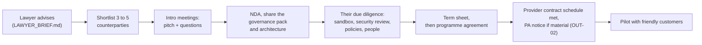

# Sponsor bank: pitch, questions and checklist

> **DRAFT for Tebogo Mvelase to adapt.** A sponsor bank is the fastest legal route to customers: it holds the licence
> and the deposits, and Forge sits on its rails (`BankLayer`, `docs/ARCHITECTURE.md` section 5.2). Nothing here has been
> sent. I can't confirm which South African banks offer such arrangements, or on what terms; the shortlist at the end is
> a list of kinds of counterparty to approach, to be checked by you and the lawyer (`LAWYER_BRIEF.md`).

## The pitch in one page

**Who we are.** Forge Mutual is a technology-led bank in preparation, founded by Tebogo Mvelase. We plan to apply for a
mutual bank registration, with a bank registration as the alternative (`LEGAL_FORMS.md`). Until then we will operate as
a **programme on your licence**: you hold the deposits, Forge builds the customer experience.

**Who we serve.** Technology businesses and their founders: companies that need rand and foreign-currency accounts,
payments, FX, treasury, working-capital credit and card acceptance, through software (`BANK_MODEL.md`).

**What we bring you.**

1. A finished platform, not a plan: accounts, payments, reconciliation, FX, savings, credit and card acceptance, on a
   ledger that can be audited, with every balance reconciled to your statements (`docs/ARCHITECTURE.md`).
2. Controls you can inspect: your customers are screened against sanctions daily and a match is frozen; limits and
   monitoring rules are data owned by named people; every decision is in an append-only audit log; payments stop on
   any open reconciliation break (`docs/THRESHOLDS.md`).
3. A governance pack: structure, 37 seats, 54 draft policies and a 114-line regulatory register, with an honest status
   on each (`docs/governance/`). We expect you to find gaps; we would rather you find them than a regulator.
4. A way out of the arrangement: `BankLayer` isolates every route-specific detail, so moving to our own licence later
   is a migration runbook, not a rebuild.

**What we ask of you.** A sponsor sandbox and wire formats; a programme agreement; your onboarding standards; and a
view on which of our products you will carry (savings, credit and card acceptance each need a separate decision).

**What we are not.** Licensed, funded or staffed beyond the founder yet. Say so first; they will ask.

## Questions to ask them

| Topic | Question |
|---|---|
| Model | Do you offer a programme or banking-as-a-service arrangement for a pre-licence fintech? Are customers yours or ours, in the deposits and in the contract? |
| Eligibility | What do you need to see before a first meeting: capital, directors fit and proper, policies, a security review? |
| Controls | Whose KYC, sanctions screening and transaction monitoring count? May we use our own provider (Didit) under your policy? Who files STRs with the FIC? |
| Payments | EFT, RTC and PayShap access: through you, in what formats (VERIFY-SPONSOR), with what cut-offs and fees? |
| Foreign currency | Do you provide an authorised-dealer arrangement and SARB reporting, or do we need a separate one? |
| Deposits | Pooled account or sub-accounts per customer? How is deposit insurance treated? What is the customer-money protection if we fail? |
| Credit | Will you carry our credit products, or must lending sit on our own balance sheet and NCR registration? |
| Economics | Fees, revenue share, minimum volumes, term, exclusivity, exit and notice. |
| Oversight | Audit rights, reporting we owe you, incident notice times (we propose 4 hours; `provider-contract-schedule.md`), your regulator notices. |
| Exit | Data return, customer migration to our own licence, non-compete. |

## What they will want from us, and where it is

| They will ask for | Where it is | Ready? |
|---|---|---|
| Business plan and projections | `docs/regulatory/policies/business-plan-outline.md`, `docs/regulatory/proforma/` | Outline and illustrative figures only |
| Directors and key people | `docs/governance/ROLES.md`, `FIT_AND_PROPER_PACK.md` | Founder only; MLRO and risk and compliance heads **vacant** |
| Policies (AML, risk, outsourcing, security) | `docs/regulatory/policies/` | Drafts, none approved |
| RMCP (FICA risk management and compliance programme) | `docs/regulatory/policies/rmcp.md` | Draft |
| Security evidence | `docs/regulatory/security-findings.csv`, CI gate output | **No penetration test yet** (SF-001) |
| Architecture and resilience | `docs/ARCHITECTURE.md`, `business-impact-analysis.md`, `deploy/k8s/` | Documented; **no production hosting** |
| Capital | `LEGAL_FORMS.md` | **None raised** |

## Process

## Who to approach

Kinds of counterparty, not recommendations; verify each with the lawyer before contact.

- **South African banks that run banking-as-a-service or partner programmes for fintechs**, including the large
  retail banks and the digital banks.
- **Banks with a business or private-bank focus on technology clients**, the Investec-type relationship
  (`BANK_MODEL.md`); they may value the clients we would bring.
- **Co-operative banks and mutual banks**, where the mutual model is already understood.
- A bank **outside** South Africa is not an option for rand deposits; foreign-currency partners are a separate search
  (`docs/PROVIDERS.md`).

## Tracking

| Counterparty | Contact | First meeting | NDA | Pack shared | Their questions | Status |
|---|---|---|---|---|---|---|
| | | | | | | |
| | | | | | | |
| | | | | | | |
