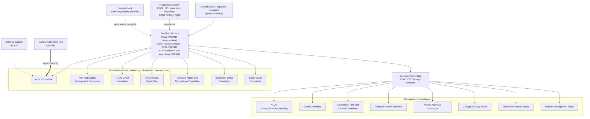
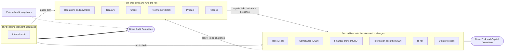
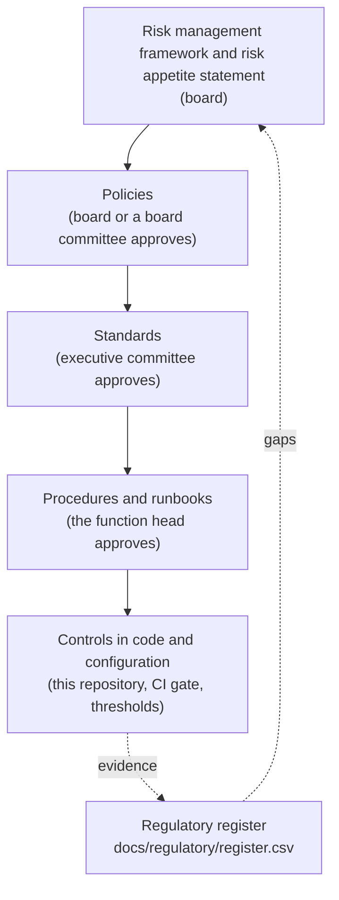
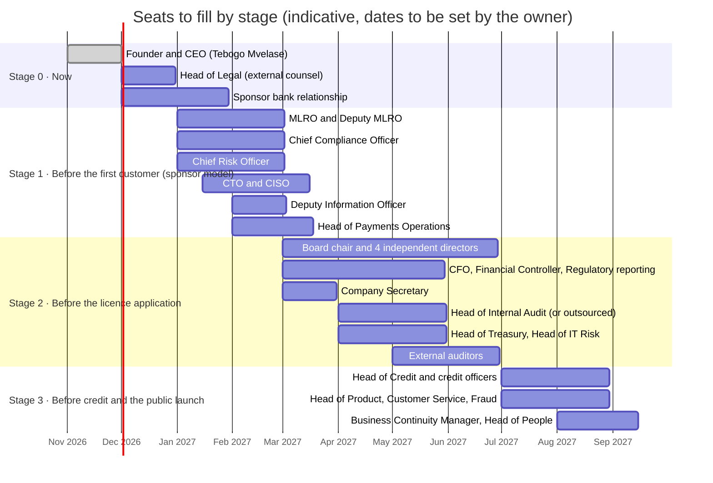

# Governance and organisation structure

> **DRAFT. Not approved.** This is the structure most South African banks use: a board with its committees, an
> executive committee, and three lines of defence. It is cut down to fit a small, technology-led bank that starts on
> a sponsor bank and applies for its own licence later. Every seat except the founder's is **VACANT**. The roster with
> what each seat needs is in [`roles.csv`](roles.csv) and [`ROLES.md`](ROLES.md). Nothing here is legal advice; a
> regulatory lawyer must confirm it against the Banks Act (or Mutual Banks Act), the Companies Act and the Prudential
> Authority's current requirements.

**Founder:** Tebogo Mvelase, proposed Chief Executive Officer and executive director. The fit-and-proper assessment
(BA 020 / DI 020) has not been done.

## 1. The whole structure

## 2. Executive organisation chart

Solid lines are management reporting. Dotted lines are the direct, unfiltered access a control function has to its
board committee: the CRO, the MLRO and the head of internal audit can go to the board without the CEO.

```mermaid
flowchart TB
  CEO["Chief Executive Officer<br/><b>Tebogo Mvelase</b>"]
  CEO --> CFO["Chief Financial Officer<br/>VACANT"]
  CEO --> CRO["Chief Risk Officer<br/>VACANT"]
  CEO --> CCO["Chief Compliance Officer<br/>VACANT"]
  CEO --> COO["Chief Operating Officer<br/>VACANT"]
  CEO --> CTO["Chief Technology Officer<br/>VACANT"]
  CEO --> CRED["Head of Credit<br/>VACANT"]
  CEO --> PROD["Head of Product<br/>VACANT"]
  CEO --> LEG["Head of Legal<br/>VACANT (external counsel at start)"]
  CEO --> HR["Head of People<br/>VACANT"]
  CEO --> IO["Information Officer (POPIA)<br/><b>Tebogo Mvelase</b> by default"]

  CFO --> TRE["Head of Treasury<br/>VACANT"]
  CFO --> FC["Financial Controller<br/>VACANT"]
  CFO --> RR["Regulatory Reporting<br/>VACANT"]
  CRO --> CISO["CISO<br/>VACANT"]
  CRO --> ITR["Head of IT Risk<br/>VACANT"]
  CRO --> DATA["Head of Data and Data Protection<br/>VACANT (Deputy Information Officer)"]
  CCO --> MLRO["MLRO<br/>VACANT"]
  MLRO --> DMLRO["Deputy MLRO<br/>VACANT"]
  MLRO --> FCA["Financial Crime Analytics<br/>VACANT"]
  COO --> PAY["Head of Payments Operations<br/>VACANT"]
  COO --> CS["Customer Service and Complaints<br/>VACANT"]
  COO --> FR["Fraud Lead<br/>VACANT"]
  COO --> BCM["Business Continuity Manager<br/>VACANT"]
  CRED --> CO["Credit Officers<br/>VACANT"]

  BRCC(["Board Risk and Capital Committee"])
  BAUD(["Board Audit Committee"])
  CRO -.-> BRCC
  MLRO -.-> BRCC
  CISO -.-> BRCC
  CCO -.-> BAUD
  HIA["Head of Internal Audit<br/>VACANT"] ==> BAUD
  SECY["Company Secretary<br/>VACANT"] --> BOARDC(["Board chair"])
```

## 3. Three lines of defence

How it maps to this repository: first-line controls are code (the ledger, limits, the licence gate, maker-checker in
the back office); second-line rules are data owned by a named person (`docs/THRESHOLDS.md`, the policy engine,
screening lists); third-line evidence is the append-only audit log and the evidence packs.

## 4. Committees: who sits, how often, what they decide

| Committee | Chair | Members | Meets | Decides or recommends | Terms of reference |
|---|---|---|---|---|---|
| Board | Independent chair (VACANT) | All directors | Quarterly, plus ad hoc | Strategy, risk appetite, policies, capital, appointments | [board charter](../regulatory/policies/board-charter.md) |
| Audit Committee | Independent NED, CA(SA) (VACANT) | 3 independent NEDs | Quarterly | Financial statements, returns, internal and external audit, internal controls | [terms](../regulatory/policies/committee-terms-of-reference.md#audit-committee) |
| Risk and Capital Management Committee | Independent NED (VACANT) | 3 NEDs, CEO, CRO, CFO attend | Quarterly | Risk appetite, ICAAP, ILAAP, recovery plan, risk policies, stress tests | [terms](../regulatory/policies/committee-terms-of-reference.md#risk-and-capital-management-committee) |
| IT and Cyber Committee | Independent NED, technology (VACANT) | 2 NEDs, CTO, CISO, Head of IT Risk attend | Quarterly | IT strategy, cyber posture, material IT changes, outsourcing of IT | [terms](../regulatory/policies/committee-terms-of-reference.md#it-and-cyber-committee) |
| Remuneration Committee | Independent NED (VACANT) | 3 NEDs | Twice a year | Pay of executives and control functions; clawback | [terms](../regulatory/policies/committee-terms-of-reference.md#remuneration-committee) |
| Directors' Affairs and Nominations | Board chair (VACANT) | 3 NEDs | Twice a year | Board composition, fit and proper, succession, evaluations | [terms](../regulatory/policies/committee-terms-of-reference.md#directors-affairs-and-nominations-committee) |
| Social and Ethics Committee | Independent NED (VACANT) | 1 NED, 2 others | Twice a year | Companies Act s.72 duties; conduct and customer outcomes | [terms](../regulatory/policies/committee-terms-of-reference.md#social-and-ethics-committee) |
| Board Credit Committee | Independent NED (VACANT) | 2 NEDs, CEO, CRO, Head of Credit | Monthly once credit is live | Large exposures and facilities above the management mandate | [terms](../regulatory/policies/committee-terms-of-reference.md#board-credit-committee) |
| Executive Committee | CEO Tebogo Mvelase | All executives | Weekly | Running the bank within the appetite | [terms](../regulatory/policies/committee-terms-of-reference.md#executive-committee) |
| ALCO | CFO (VACANT) | CEO, CRO, Head of Treasury | Monthly | Liquidity, funding, interest-rate risk, FX positions, rates paid | [terms](../regulatory/policies/committee-terms-of-reference.md#alco) |
| Credit Committee | Head of Credit (VACANT) | CRO, CFO, credit officers | Weekly | Facilities within mandate; arrears and write-offs | [terms](../regulatory/policies/committee-terms-of-reference.md#credit-committee) |
| Operational Risk and Control | CRO (VACANT) | COO, CTO, CISO, CCO | Monthly | Incidents, losses, control failures, risk register | [terms](../regulatory/policies/committee-terms-of-reference.md#operational-risk-and-control-committee) |
| Financial Crime Committee | MLRO (VACANT) | CCO, COO, Fraud lead | Monthly | Monitoring rules, case backlog, exits, sanctions | [terms](../regulatory/policies/committee-terms-of-reference.md#financial-crime-committee) |
| Product Approval Committee | Head of Product (VACANT) | CRO, CCO, CFO, COO, CTO | As needed | New products and changes; signs the licence-gate decision `DEC-nnnn` | [terms](../regulatory/policies/committee-terms-of-reference.md#product-approval-committee) |
| Change Advisory Board | CTO (VACANT) | CISO, Head of IT Risk, COO | Weekly | Production changes; emergency changes after the fact | [terms](../regulatory/policies/committee-terms-of-reference.md#change-advisory-board) |
| Data Governance Council | Head of Data (VACANT) | CTO, CISO, CCO, Information Officer | Quarterly | Data classes, retention, residency, access | [terms](../regulatory/policies/committee-terms-of-reference.md#data-governance-council) |

## 5. Policy hierarchy

The full list of policies, their owners and approvers is in [`POLICY_FRAMEWORK.md`](POLICY_FRAMEWORK.md).

## 6. Who can approve what

| Decision | Proposes | Approves | Second pair of eyes | Recorded in |
|---|---|---|---|---|
| Risk appetite statement | CRO | Board, on Risk Committee recommendation | Internal audit reviews yearly | Board minutes, `docs/DECISIONS.md` |
| A policy | Policy owner | Committee in `POLICY_FRAMEWORK.md` | Second line | Policy header |
| A threshold value | Owner in `THRESHOLDS.md` | Approver in `THRESHOLD_OWNERS.md` | Never the proposer | `docs/DECISIONS.md` |
| A new product or turning one on (`FORGE_APPROVAL_*`) | Head of Product | Product Approval Committee, then Risk Committee for credit and deposits | CCO and CRO | `docs/DECISIONS.md` as `DEC-nnnn` |
| A credit facility | Credit officer | Within mandate: credit officer; above: Credit Committee; large exposure: Board Credit Committee | CRO for large exposures | Lending service decision record |
| A material outsourcing | Function head | Board, after PA notice where required | CRO, Head of Legal | Outsourcing register |
| A production change | Engineer | Change Advisory Board (two-person review in code) | CISO for security changes | Git history, CI gate |
| A suspicious transaction report | Analyst | MLRO | Deputy MLRO | Compliance case |
| Freezing or unfreezing a customer | Compliance engine / analyst | MLRO | CCO | Party status history, case |
| Writing off a loan | Head of Credit | Credit Committee | CFO | Ledger, decision record |

## 7. How the structure grows

Not every seat is needed on day one. The order follows what must exist before each stage.

## 8. Rules for sharing seats while small

- The CEO may not also be the chair, the CRO, the MLRO or the head of internal audit.
- The CRO may not be the CFO or run any first-line function.
- The MLRO and CCO may be one person only if the Prudential Authority and the sponsor bank accept it; then the Deputy
  MLRO must be appointed, because someone else must approve the MLRO's own changes.
- Internal audit may be outsourced, but only with the PA's prior written approval (register row BR-05), and never to
  the external auditor.
- At least two board members must be employees (register row MR-03 for a mutual bank): the CEO and the CFO.
- A majority of the board, and every chair of the audit and risk committees, should be independent non-executives.
