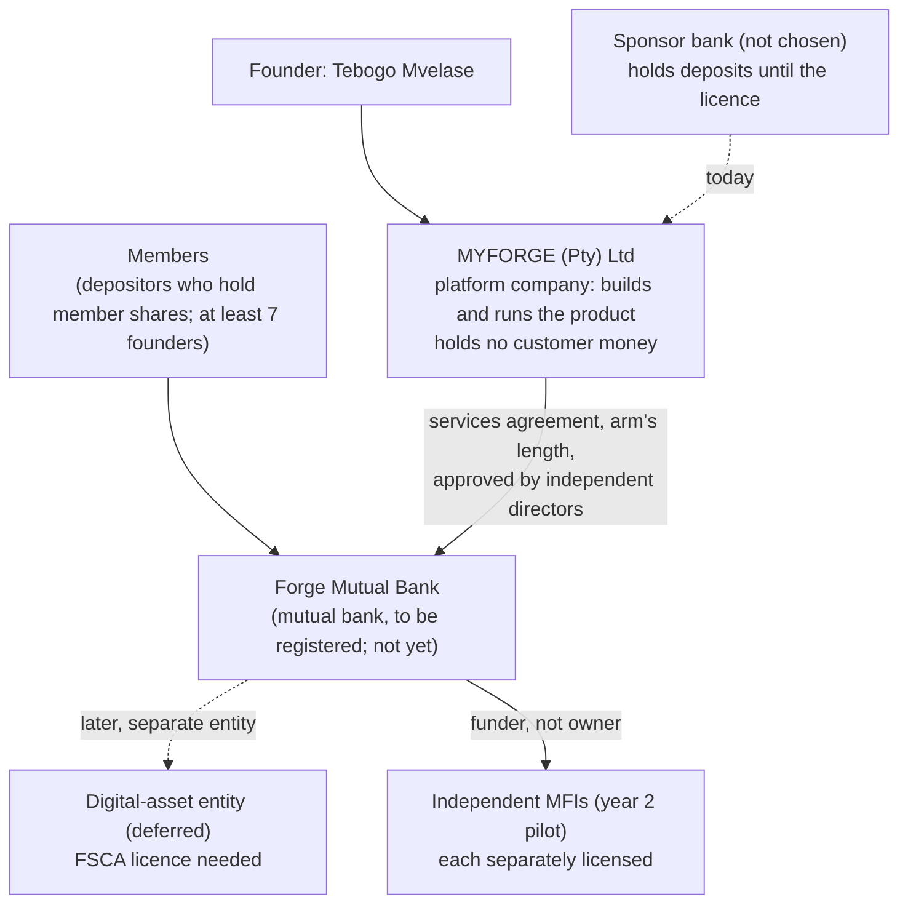

# Forge Mutual Bank: draft business plan and public-interest motivation

> **DRAFT. Not approved. Not for submission.** Prepared 2026-11-24 by Claude from `docs/CONTEXT.md`, `docs/BANK_MODEL.md`, `docs/governance/`, the regulatory register
> and the repository. It follows `docs/regulatory/policies/business-plan-outline.md` and register row LIC-15 (business plan, public-interest motivation, rationale,
> group structure chart, dividend policy, constitution, auditor names, fees). **Every number here is either taken from the concept document (itself unverified) or
> marked as a gap. There are no founder-supplied financials in this repository and none are invented here.** The CFO (a vacant seat) and an accountant must replace
> sections 8 to 10 with real work before anything is submitted. Nothing in this document is legal or financial advice.

**Status in plain words.** Forge Mutual Bank has no licence, no customers and holds no money. A sponsor-bank launch is planned first; the mutual bank is the
destination, and the ordinary bank route is kept open (ADR-0020, open). The founder is Tebogo Mvelase (R01). Thirty-six of the thirty-seven governance seats are
vacant.

| Marker | Meaning |
|---|---|
| **GAP** | Needed for the application and not available in the repository. A person must supply it. |
| **VERIFY** | A fact from the concept documents to be confirmed against a source before it is relied on. |
| **ASSUMPTION** | A figure that is a modelling assumption, not data. |

## 1. Summary

Forge is a South African bank and money platform for technology companies and the people who build them. A company holds rand and US dollars in one workspace,
receives foreign revenue, pays staff, suppliers and contractors at home and abroad, and runs approvals as a team. It starts on a sponsor bank, which holds the
deposits, then applies for its own licence as a **mutual bank owned by its depositor-members**. Its edge is a specialist service on open, self-hostable software,
not price or reach (CONTEXT s3, s12).

**What exists today:** a working software platform (customer front door, ledger, payments, multi-currency accounts, savings, lending, merchant acquiring, card issuing
and third-party offers, the last two switched off), a compliance layer (sanctions screening, monitoring, regulatory reporting shells), a governance pack of 55 draft
policies and 37 defined roles, and both legal forms built into the code. **What does not exist:** capital, a board, a sponsor bank contract, members, a licence, and
customers.

## 2. Legal and ownership structure (group chart)

- **Entities and what each may hold** are in CONTEXT s4: the platform company holds no money; the bank layer holds deposits; a separate digital-asset entity (deferred) would
  hold stablecoins; MFIs are independent. Value moves between them only through a reconciled settlement step.
- **Ownership of the mutual:** no outside shareholders; members hold member shares, one member one vote (`CONSTITUTION_DRAFT.md`).
- **Related party risk (to confront, not hide):** the founder controls MYFORGE, which would be the bank's most important supplier. The services agreement, fees, the brand
  licence and the exit terms are a first-order governance matter for the board's independent directors and for the Prudential Authority (outsourcing, register OUT-01).
- **GAP:** the legal advice that the mutual form is available and appropriate for a technology-business membership (ADR-0020; `docs/governance/LAWYER_BRIEF.md`).
- **GAP:** shareholder and controller details for MYFORGE, and fit-and-proper information for every director and executive (`docs/governance/FIT_AND_PROPER_PACK.md`).

## 3. Route and licence type

| Stage | Bank layer | What changes for customers | Needs |
|---|---|---|---|
| A (now) | Sponsor bank holds deposits; Forge runs a sub-ledger and reconciles daily | ZAR and USD accounts, payments, FX, workspace | A signed sponsor bank; an authorised-dealer partner for FX; FICA registration |
| B (licensed) | Forge holds its own licence | Direct payment rails (for example PayShap); tokenised deposits inside the bank | The licence in this application |
| C (cleared) | Unchanged | Stablecoin corridors through a separate entity | A legal clearance that does not exist today |

The application is for **registration as a mutual bank** (planned) or a **bank** (kept open), made while stage A runs. The licence is not a launch prerequisite; a
sponsor bank is. The business plan therefore has to show the regulator two things: the sponsor-stage operation that already runs, and why the bank-stage operation is
better for members than staying on a sponsor.

## 4. Market and customers

**First customer group (ADR-0022, accepted): technology companies.** Startups and scale-ups, profitable tech SMEs, AI and deep-tech firms, and founders personally (kept
separate from their companies). Adjacent customers: cross-border SMEs such as exporters, importers and freelancers paid from abroad (CONTEXT s6).

**Their core jobs:** receive USD from a foreign customer and see it arrive quickly; pay a USD cost without converting first; convert USD to rand for payroll at a
disclosed price; pay a foreign supplier with one all-in quoted cost; pay local staff; approve payments as a team with an audit trail.

**Size of the market (VERIFY, from earlier notes):** about 1,246 startups (StartupBlink), 53,082 technology companies (Tracxn), 91,816 registered software companies
(CIPC, mostly tiny or inactive). The serviceable market is **an estimate of a few thousand startups and scale-ups plus several thousand active tech SMEs, agencies and
exporters**. Startup funding is thin: about $83M in the first half of 2026, against $327M in Egypt, $254M in Nigeria and $126M in Kenya (VERIFY).

**GAP:** none of this is yet tested with real customers. The plan's Phase 0 calls for about twenty customer interviews and a design-partner cohort; they have not been run.
The wedge test is stated in CONTEXT s12: if Forge cannot beat roughly **1% all-in cost with same-day settlement** on real customer statements, cross-border payments are
not the wedge.

**Competition (VERIFY):** Capitec (26.6M active clients, 686,000 business clients), Lesaka with Bank Zero, Revolut (filed for a South African banking licence in
November 2025), Wise, the large banks, payment gateways and crypto exchanges. Forge cannot win on price, reach, balance sheet or speed to a licence; it can win as a
specialist (CONTEXT s11 to s12).

## 5. Products and services

v1 (sponsor stage): ZAR business accounts; a USD account through one partner bank; cross-border payments and FX through an authorised-dealer partner; domestic payments;
identity checks; a web workspace with roles and approvals; a back-office console; built-in sanctions screening, transaction monitoring and FIC reporting; deposit
concentration alerts.

Built but **not offered, because each needs a licence or approval that does not exist**: savings and notice deposits, working-capital loans, overdrafts and revenue-based
financing, merchant acquiring, virtual debit cards, and third-party investment and crypto-asset introductions. The software refuses to run any of them in production without
a named approving decision (`pkg/licence`). **Every third-party product is provided, licensed and monitored by the third party, never by Forge.**

Explicit non-goals (CONTEXT s7.3): DeFi, self-custody, Forge-issued stablecoins, a Forge card BIN, CBDC work and mass-market marketing.

## 6. Public-interest motivation (LIC-15)

*A draft argument for the lawyer and the founder to test. Each claim needs evidence; none is yet evidenced.*

1. **Cross-border friction for the people who earn foreign currency for South Africa.** Receiving USD revenue and paying foreign costs is slow, opaque and manual at
   present (CONTEXT s2). A specialist service with one all-in price and disclosed spreads is a consumer-protection benefit. *Evidence needed: fee and settlement data from real
   customer statements.*
2. **Member ownership and fair pricing.** A bank owned by its depositors returns surplus as better pricing or rebates instead of outside dividends, and has a credible answer
   to fee mistrust. *Evidence needed: the constitution's surplus rule and a pricing policy approved by members.*
3. **Access for groups that banks serve poorly.** Savings groups, stokvels, co-operatives and micro-lenders could become members and own their funder; the planned MFI network
   would offer cheaper registered credit in place of unregistered lenders (CONTEXT s2, s10). *Evidence needed: the pilot in section 12, with measured default, cost and
   borrower-rate results. The concept document itself records that randomised studies of microcredit found no significant average effect on household income, so this claim must
   be made carefully.*
4. **Competition and local control.** A new entrant on open, self-hostable software that can run in South Africa under local control reduces dependence on foreign vendors
   (CONTEXT s3.3 principle 6). *Evidence needed: the hosting decision (ADR-0002) and the outsourcing register.*
5. **Safety designed in.** Reconciliation against the sponsor, a ledger with one writer, an append-only audit log, a default-deny rule engine, and consent for data use are
   already built and tested. *Evidence: the test gate and the regulatory register.*

**GAP:** a regulator will want proof that the new bank is needed and not just wanted: market data, member commitments (letters of intent from prospective founders and
members), and a statement of how the bank differs from existing mutual and co-operative banks. None is in the repository.

## 7. Governance, board and key persons

The target governance is in `docs/governance/STRUCTURE.md`, `ROLES.md` and `POLICY_FRAMEWORK.md`: a board with committees (audit, risk and capital, nominations and
remuneration), three lines of defence, 55 draft policies and 37 defined seats.

| Item | State |
|---|---|
| Board | **None.** The constitution draft sets the shape: at least two employee directors (MR-03), a majority-independent non-executive group, directors elected by members. |
| Seat holders | 1 of 37 named (founder, Tebogo Mvelase, as R01). The accountable roles for compliance, money laundering, risk, finance, audit, legal, company secretary, treasury, IT risk and security are **vacant**. |
| Fit and proper | The filing pack (DI 020 for a mutual bank) and tracker exist; nobody has filed. |
| Independence | The founder's control of the platform supplier makes independent directors and an independent chair essential, not optional. |

**GAP:** names, curricula vitae, qualifications and references for each director and executive. A business plan with an empty board will not be accepted.

## 8. Financial projections

> **This section is a placeholder by design.** The repository holds an *illustrative* pro forma and the concept document's *illustrative* economics. They are shown below
> so that nobody mistakes them for forecasts, and so the gaps are visible.

**What the concept document assumes (CONTEXT s8.3; ASSUMPTION, in US dollars, not converted):**

| Year 5 | Conservative | Base | Optimistic |
|---|---|---|---|
| Customers | 3,200 | 9,000 | 18,000 |
| Revenue | about $1.8M | about $8.9M | about $27.7M |
| Operating result | about -$4.6M | about -$3.3M | about +$4.8M |
| Deposits | about $48M | about $270M | about $900M |
| Peak funding need | about $17.7M | about $19.8M | about $16.8M |
| Customers to break even | about 10,900 | about 10,100 | about 10,400 |

The model assumes revenue per customer of $500, $900 or $1,400 a year growing 10% a year, variable costs of 25% of revenue and operating costs rising from $2M to $16M.
It **excludes** the sponsor bank's revenue share, licence capital, credit losses and compliance headcount, so the real position is harder.

**What the repository's pro forma shows (`docs/regulatory/proforma/`, illustrative, rand):** deposits of R150M, R600M and R1.5bn at the end of years 1 to 3, with small
surpluses. It exists to show the shape of the DI 100 and DI 200 forms. **It does not agree with the concept document's economics** (for example, year-5 base deposits of about
$270M against R1.5bn at year 3). One consistent model must replace both.

**Three weak points a regulator will test:**

1. **Break-even needs about 10,000 business customers**, which is close to the whole serviceable market in section 4. Either the plan needs expansion (other African markets,
   adjacent customers, the MFI network) or the economics need to be rebuilt. The concept document says the same.
2. **Volatile deposits.** Technology deposits swing with funding cycles and are correlated (the Silicon Valley Bank lesson, CONTEXT s16). The plan needs concentration limits,
   stress tests and a liquidity buffer sized to that, and a mutual's members can redeem shares (constitution clause 4.3).
3. **Capital.** The minimum for a mutual bank is understood to be R10M (VERIFY) and for a bank R250M (VERIFY), but the concept document puts the funding need at about
   **$15M to $20M before profit in the base case**. The minimum is not the need.

4. **Liquid assets and the reserve balance.** Building DI 310 from the official form showed that a balance with a sponsor or partner bank is
   **not** a liquid asset under the Mutual Banks Act (only Reserve Bank notes and coin, gold, Reserve Bank clearing balances, Treasury bills,
   government, Reserve Bank and Land Bank securities count). As a registered mutual bank Forge would need, on the form's figures (VERIFY the
   current rates), about **5% of adjusted liabilities in liquid assets plus a 2.5% average reserve balance with the Reserve Bank**, which earn
   little or nothing. The model must hold them and price their cost; today's ledger has no account for any of them, and the returns code reports
   the shortfall.

**GAP, to be built with the CFO and an accountant:** a consistent three-to-five-year model (balance sheet, income statement, capital and liquidity, with customer, deposit,
lending and cost drivers), a sponsor-bank revenue share, stress scenarios, and the pro forma returns (DI 100, 110, 200, 300, 400, 430, 700) regenerated from that model
(`make proforma`). DI 100 and DI 200 now use the forms' own line numbers (`docs/regulatory/returns/`); the transcription needs a second person's check.

## 9. Capital and funding plan

| | Amount | Source | State |
|---|---|---|---|
| Minimum registered capital (mutual bank) | **R10M** (VERIFY) | Founder capital and member shares | **GAP: nothing raised** |
| Minimum registered capital (bank option) | **R250M** (VERIFY) | Investors | **GAP** |
| Funding need before profit (base case) | about **$15M to $20M** (ASSUMPTION) | To be decided: members, development finance, founder, strategic partners | **GAP** |
| Loss-absorbing buffer above the minimum | to be set by the CRO and CFO | | **GAP** |

A mutual cannot easily raise venture equity or be sold (CONTEXT s5.2), so the plan must say where the money comes from. Options to evaluate with the lawyer and an
accountant (none is chosen): founder capital; member shares from prospective members (each priced and capped by the constitution); development-finance institutions; a
subordinated or other capital instrument that the Prudential Authority accepts for a mutual (`VERIFY`); revenue from the sponsor-stage business.
**Proof of funds** in writing is a licensing requirement (LIC-02) and nothing here replaces it.

## 10. Risk management and compliance framework

- **Risks to manage (MR-01, JS1):** solvency, liquidity, credit, currency, market, interest-rate, counterparty, technological and operational. Drafts: `risk-management-framework.md`,
  `liquidity-and-contingency-funding-plan.md`, `concentration-policy.md`, `it-risk-management-framework.md`, `outsourcing-policy.md`.
- **Compliance:** FICA (KYC, sanctions screening, goAML reporting, Travel Rule where crypto transfers arise), POPIA, exchange control (through an authorised dealer), National
  Credit Act (for any lending), and deposit insurance (CODI) disclosure. Counsel has not reviewed any of it.
- **Controls built into the software:** reconciliation against the sponsor, one ledger writer, an append-only audit log, default-deny rules, maker-checker approvals and
  consent for personal data. Evidence is the test gate and the register.
- **Status:** all 55 policies are drafts; none is approved because no body exists to approve them.

## 11. Systems, security and outsourcing

Summarised from `docs/ARCHITECTURE.md`: TigerBeetle ledger, Apache Fineract core, Temporal workflows, Open Policy Agent rules, Kafka events, PostgreSQL, mutual TLS between services,
secrets from files, security scanning and a published recovery procedure. Hosting plan: Fly.io for a synthetic-data preview; AWS (Cape Town proposed) for production
(`docs/HOSTING.md`); **production hosting does not exist yet and nothing has been applied to a cloud account.**

**Material outsourcing (OUT-01, E1 to E3 in the pack):** the platform company (core and reporting IT), the sponsor bank, cloud hosting, identity verification (Didit), sign-in
(WorkOS), and others in `docs/regulatory/outsourcing-register.csv`. The Prudential Authority needs prior notice of material outsourcing (20 working days is the working
assumption, VERIFY).
**GAP:** an independent penetration test, a production disaster-recovery site and test (JS1-12), and a named IT risk function (JS1-03).

## 12. Staged plan and milestones

| Stage | Timing (estimate; VERIFY) | Exit test |
|---|---|---|
| Today | now | Software built and tested on a local stack; every external party simulated |
| Legal and people | next 3 months | Lawyer's advice; ADR-0020 closed; seat holders named; seven founders identified |
| Sponsor and partners | months 3 to 9 | Signed sponsor bank, USD partner, authorised-dealer partner; sanctions list licensed |
| Production readiness | months 6 to 12 | Hosting applied; penetration test passed; Prudential Authority outsourcing notice made |
| Closed launch | months 9 to 15 | About twenty design-partner customers; the 1% wedge test run on real statements |
| Application | when capital, board, founders and policies are in place | Pre-application meeting; filing |
| Registration | **typically 18 to 24 months or more from a complete application** (general knowledge; confirm with the lawyer) | Licence and Financial Sector Conduct Authority concurrence |
| After registration | | Migrate from the sponsor's books (the migration runbook is **not yet written**; `LEGAL_FORMS.md` refers to one that does not exist); consider the MFI pilot and cards |

**Proof points that would make Forge significant (CONTEXT s17):** cross-border payments under about 1% all-in cost with same-day settlement on real statements from fifteen to
twenty companies; one franchised MFI that is profitable; evidence that pooled data improves credit scores across independent lenders.

## 13. Dividend and surplus policy

Surplus is applied first to required reserves, then returned to members as rebates, better rates or (only if the lawyer advises it is compatible with the form) a limited
dividend, by decision of the members' meeting, and only if the bank would still meet its capital and liquidity requirements. See `CONSTITUTION_DRAFT.md` clause 8 and decision
2 there.

## 14. Other items the application needs (LIC-15)

| Item | State |
|---|---|
| Constitution or articles | Draft: `CONSTITUTION_DRAFT.md` (for the lawyer) |
| Group structure chart | Section 2 above (to be redrawn with real ownership percentages) |
| Auditor names (form DI 005 for a mutual bank) | **GAP**: no auditor appointed; one registered for banks is needed |
| Fees and tariffs | **GAP**: a fee schedule approved by the board and reviewed by the lawyer (CONTEXT s8.2 sets the principle: one all-in price, disclosed spreads) |
| Public-interest motivation | Section 6, to be evidenced |
| Pro forma returns | Illustrative only (`docs/regulatory/proforma/`) until section 8 is built |
| Pre-application meeting and FSCA concurrence (LIC-16) | **GAP**: not requested |

## What must happen before this plan can be submitted

1. The lawyer's advice, and ADR-0020 closed.
2. A CFO and an accountant build the model in section 8 and the capital plan in section 9; the founder confirms every ASSUMPTION or replaces it with data.
3. A board, executives and independent directors are named, with fit-and-proper statements.
4. At least seven founding members and written commitments for capital.
5. Customer evidence: interviews, letters of intent and a design-partner cohort.
6. A signed sponsor bank and the other partners in section 12.
7. The policies in section 10 approved by the board once it exists.
8. The document reviewed by the lawyer for statements about regulation, and by the founder for statements about intent.

*Nothing in this plan has been sent to any regulator, investor or customer.*
