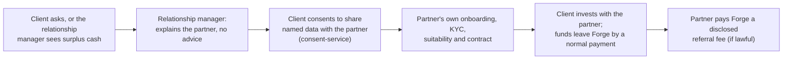

# Investments and wealth: a partnership, not a product

> **DRAFT.** Investec's model combines banking with investment, estate and tax advice. Forge will not provide those
> itself: they need separate licences, people and a different risk culture. The realistic route is an **introducer
> (referral) partnership** with a licensed provider. Nothing here is built and no partner is approached. Not legal advice;
> the lawyer (`docs/governance/LAWYER_BRIEF.md`) settles every regulatory point below.

## Position

| | Forge | Partner |
|---|---|---|
| Deposits, payments, FX, credit, card acceptance | Yes | No |
| Investment advice and management, unit trusts, tax and estate planning | **No** | Yes, under its own FSP licence |
| Crypto-asset advice or custody | **No** | A licensed CASP, if at all |
| Holding a client's investments | **No** | Partner or its custodian |

## Why not build it

- Advising on or managing investments is a regulated financial service (Financial Advisory and Intermediary Services
  Act: an authorised FSP, key individuals and representatives with regulatory exams). Confirm the current rules and
  whether a bank can introduce clients under its own licence or a representative arrangement.
- It adds conduct risk (suitability, disclosure, complaints) that a small bank should not carry in its first years.
- The client's need is a good answer, not necessarily ours: a partner can give it.

## How a referral would work

Rules (PROPOSED):

1. The client always deals with the partner under the partner's terms. Forge's name is not on the product.
2. **Consent first.** Data goes to the partner only for the purpose, fields and time the client agreed, recorded in the
   consent service and revocable (POPIA; `docs/regulatory/data-classes.csv`).
3. Referral fees are disclosed to the client and approved by the Compliance Officer; no fee is tied to a product that is
   not suitable. Confirm the legal basis with the lawyer.
4. Forge makes no statement about returns and gives no comparison between products.
5. A transfer to the partner is an ordinary payment, screened and limited like any other.
6. The partner is a material outsourcing candidate if Forge relies on it for a client service
   (`docs/regulatory/policies/provider-due-diligence-procedure.md`, `provider-contract-schedule.md`).
7. Forge keeps a register of referrals and a complaints route that reaches the partner.

## Choosing a partner

What to look for: authorised FSP with a clean regulatory record; custody with a recognised custodian; transparent
fees; technology that can be reached by API; comfortable with technology founders; a stance on crypto assets that
matches our appetite (`docs/governance/RISK_APPETITE_DECISIONS.md`, rows 15 to 17). Start with two or three
conversations; the sponsor bank may have a preferred partner.

## What would need building, later

| Item | Status |
|---|---|
| A referral register and consent screen in the back office | Not built |
| A consent purpose "share with an investment partner" in the consent service | Not built (the service supports purposes generally) |
| An API link to a chosen partner | Not built; depends on the partner |
| A referral-fee ledger entry (income) | Not built; use FEE income (2002) |

## Decision needed

Whether to pursue this at all before the sponsor bank and first pilot. Recommendation: **no**. Revisit after the pilot,
when clients with surplus cash have actually asked for it.
